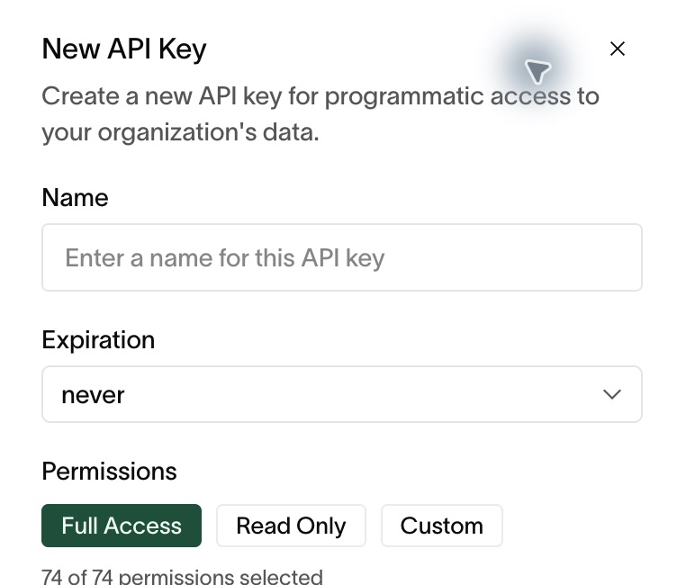

# Automation and API access

Use scoped API credentials for repeatable work and MCP for compatible agent
clients. Interactive users continue to sign in through Gideon.

## Create a scoped API key

Requires `apiKey:create`. Listing keys requires `apiKey:read`; revocation
requires `apiKey:delete`.

1. Open **Settings → API Keys → Add API Key**.
2. Give the key a name that identifies its integration and purpose.
3. Choose an expiration appropriate for the integration's lifetime.
4. Choose **Read Only** for reporting, or **Custom** and select the exact
   permissions needed. Review the permission count before creating the key.
5. Create the key and copy it immediately into your approved secret store.
   The secret value is shown only once.
6. Test a read operation against the intended organization before enabling
   mutations or scheduled jobs.

*Review permissions deliberately: the form can initially select Full Access.*

For API requests, send the key in the `x-api-key` header. Use the base URL
provided for your deployment. Do not put keys in URLs, screenshots, tickets,
chat prompts, or source control. Refer to the
[API overview](../../packages/docs/api-reference/overview.mdx) for request and
response conventions.

## Rotate or revoke a key

For planned rotation, create a replacement with the same or narrower scopes,
update the integration's secret store, and verify a successful request.
Then revoke the old key. If a key was exposed, revoke it promptly and check
which systems were using it before restoring access with a new credential.

Check the key list's **Expires** and **Last Used** columns during access
reviews. An unused or non-expiring key still needs an owner and purpose.

## Connect an agent through MCP

Use [MCP setup](mcp-setup.md) to choose hosted Streamable HTTP or local
stdio and configure authentication. Then follow the
[worked examples](mcp-examples.md) for task lists, framework progress, and
the Trust Center overview, including exact discovery and execution calls.

Start with a read-only key and confirm the returned organization before
requesting changes. The setup guide explains endpoint selection, supported
authentication, credential rotation, and connection troubleshooting.

## Prepare evidence for an auditor

1. Complete the relevant policy and evidence reviews.
2. Use **Export All Evidence** on **Evidence**, or the available read-only
   auditor export.
3. Open the downloaded output and check the period, expected records,
   attachments, and control context.
4. Share through your organization's approved channel and access policy.

Exported evidence may contain employee or infrastructure information. A
successful download confirms delivery of a file; it does not establish
that every control is complete.

## Troubleshooting

| Problem | Check |
| --- | --- |
| Authentication rejected | Correct deployment, key value, expiration, and revocation status. |
| Action forbidden | Key scopes and the permission required for that operation. |
| Wrong organization | Client configuration and tenant assignment; a URL cannot grant cross-tenant access. |
| Agent cannot find an operation | Search using the business action and consult the API/MCP guide for supported operations. |
| Export missing expected proof | Reporting scope, task attachments, completion state, and control mappings. |

Related: [Roles and access](roles-and-access.md),
[Organization settings](organization-settings.md),
[Evidence and tasks](evidence-and-tasks.md).
