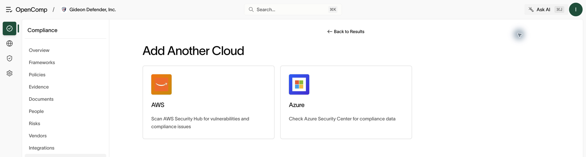
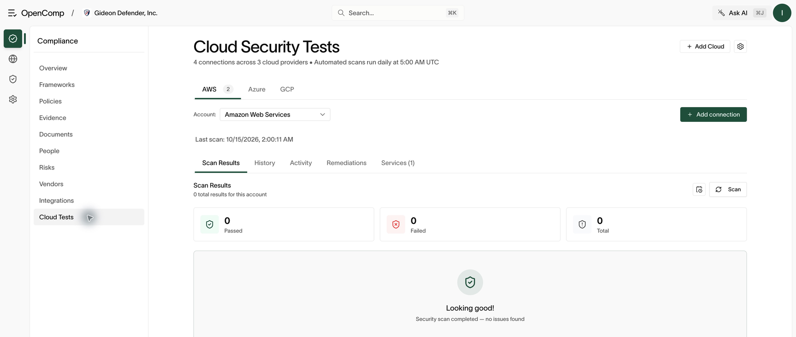

# Cloud security

Connect AWS, GCP, and Azure accounts, run configuration checks against them,
remediate findings, and disconnect accounts you no longer monitor.

Requires `integration:create` to add accounts, `integration:update` to run
scans and change settings, and `integration:delete` to disconnect.

## Connect an account

1. Open **Cloud tests** and click **Add Cloud** (or open
   **Integrations → provider → Add**).
2. Pick the provider (AWS, GCP, or Azure) and follow the provider-specific
   setup guide. For AWS this means creating an IAM role with the supplied
   external ID — copy the values exactly; a wrong external ID fails closed.
3. If required settings are missing, a **Configure** dialog appears. Saving
   it triggers the first scan automatically.

You can connect **multiple accounts per provider** (for example several AWS
accounts). Use the provider tabs and the **Account** selector to switch between them.
The Add Cloud screen offers providers available for a new connection; an
existing provider tab does not guarantee that new setup is enabled there.

*Choose from the setup options offered by your deployment.*

## Run checks

1. Select the provider tab, then choose the account in **Account**.
2. Click **Scan** (called **Run Scan** in some deployments). Automated scans also run daily at 5:00 AM UTC.
3. Browse results by service and check group. Open a check for its definition,
   affected resources, and the raw evidence JSON.
4. If a scan fails with permissions errors, open the permission error panel:
   it names the missing permissions — add them to the role and re-run.
5. Accounts connected before a platform cutoff show a **Reconnect required**
   banner: disconnect and reconnect through the integrations page.

*Check Scan Results, History, Activity, Remediations, and Services for the selected account.*

## Confirm a scan completed

Check the latest scan timestamp and **History** for a completed run. Review
the passed, failed, and total counts for the correct account. Zero results
does not mean a clean scan: check enabled **Services**, account access, and
scan errors before drawing conclusions.

## Remediate

- **Single fix** — remediate one finding from its detail view.
- **Batch remediation** — fix a group at once; review the merged script
  before applying.
- **Remediation history** — every fix is recorded; denied or skipped items
  stay visible so auditors see the full trail.
- **AWS scan engine** — per AWS account, choose between OpenComp scanners
  and AWS Security Hub from the account settings (gear icon).

## Account settings

The gear icon opens per-account settings: regions, credentials/role,
remediation roles, and scan engine. Changes apply to that account only.

## Disconnect (remove) an account

1. Open the account's settings (gear icon on Cloud tests, or **Settings**
   on the provider page → Account settings sheet).
2. Scroll to the danger zone and click **Disconnect**. Confirm.
3. The account stops being scanned. Historical findings remain for the audit
   trail.

Disconnecting requires `integration:delete`. Without it, the button is
hidden — ask an owner or admin.

## Practical guidance

- One connection per account — don't stack duplicate connections for the
  same account ID.
- Keep regions tight: scanning regions you don't use creates noise.
- Treat persistent permission errors as findings, not tooling issues — a
  scanner that can't read an account can't assure it.
