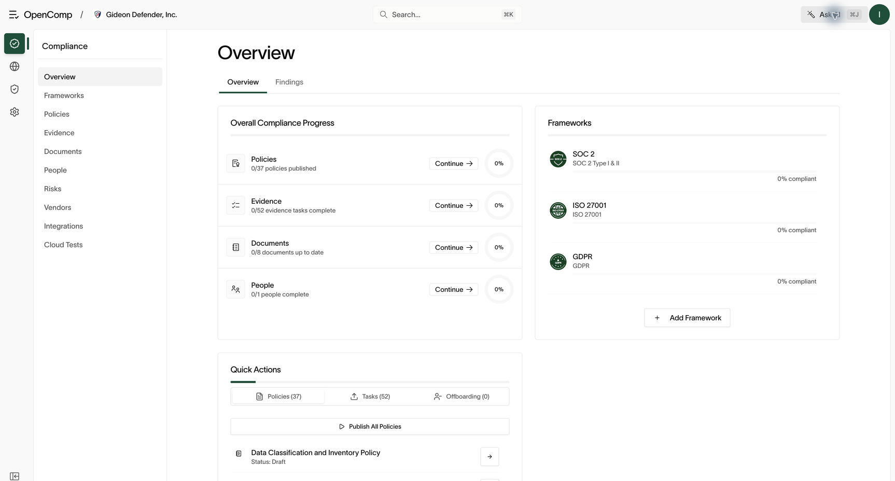
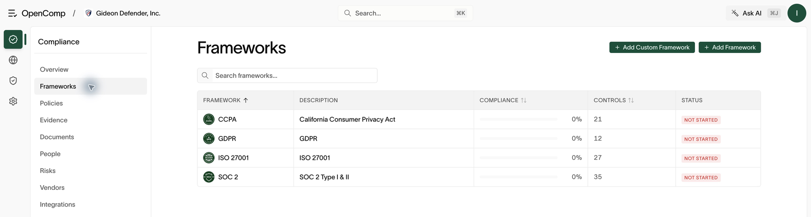
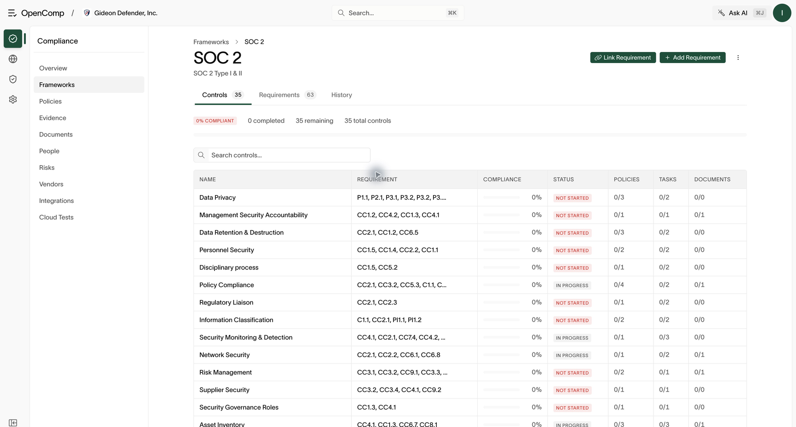

# Compliance overview

Requires `framework:read` to view. Adding frameworks requires `framework:create`; changes require `framework:update`.

## Dashboard

**Overview** is the landing page. It shows:

- Compliance score per active framework, with control coverage.
- Policy status (draft, in review, published, archived).
- Task completion (done vs incomplete).
- Document and people scores.

Click any framework, policy, or task to drill into its detail page. The dashboard includes **Overview** and **Findings** tabs. Framework detail
pages include **Controls**, **Requirements**, and **History**.



*A percentage describes recorded coverage; it is not a certification or an audit opinion.*

## Frameworks

**Frameworks** lists the standards activated for your organization (for
example SOC 2, ISO 27001, HIPAA, GDPR), each with a compliance percentage.

### Add a framework

1. Open **Frameworks**.
2. Click **Add Framework**.
3. Choose from the available standards. Only standards not already active are
   listed.



*Search the framework list, then open a standard to see its controls.*

### Work a framework

1. Open a framework instance to see its requirements and controls with
   coverage status.
2. Open a control to see the policies, evidence, and tasks mapped to it.
3. Close gaps by publishing policies, completing tasks, and attaching
   evidence. Scores update as coverage improves.
4. When a framework vendor ships a new version, use the **review update**
   flow to accept the sync.



*The control table shows mapped policy, task, and document completion.*

## Controls

There is no standalone control list — browse controls through the Overview
or through a framework. A control detail page shows its status and everything
mapped to it (policies, evidence, tasks).

## Confirm coverage changes

After publishing a policy or completing evidence, reopen the mapped control
and check its completion counts. If coverage is unchanged, check **Mappings**
on the source record, its publication or completion status, and whether you
are viewing the expected framework. An uploaded file by itself does not
prove every mapped requirement has been satisfied.

## How the pieces fit

```text
Framework → requirements → controls → policies + evidence/tasks
```

- Frameworks define **what** must be true (controls).
- Policies state **what the company does**.
- Tasks and evidence **prove** it.
- Scores measure coverage across the chain.

Next: [Policies](policies.md), [Evidence and tasks](evidence-and-tasks.md).
