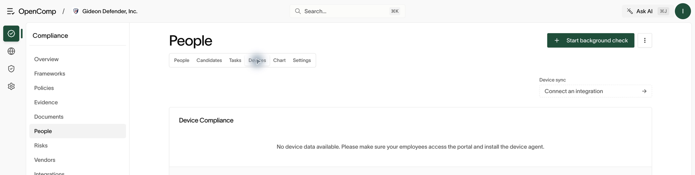

# Devices

Track employee devices from FleetDM, the OpenComp device agent, or manual
inventory, and revoke access when devices are lost or reassigned.

## Coverage sources

Open **People → Devices**. Each device comes from one of:

- **FleetDM** — enrolled hosts with policy results (including an MDM check
  on macOS).
- **Device agent** — active agent sessions with last check-in.
- **Manual inventory** — hand-maintained device records.

The compliance chart summarizes coverage across the organization. Open a row
for host details, policy results, and linked member.

*An empty device view means coverage has not been recorded; it does not mean devices passed.*

## Link devices to people

A device counts toward a person's compliance only when linked to their
member record. Unlinked devices appear for triage — link them or remove
them.

## Revoke access

For a lost device or a departure:

1. Open the device (or the employee → **Device** tab).
2. Choose **Revoke agent access** and confirm.
3. The session is cut. Follow the [offboarding checklist](people.md) for the
   remaining steps (account disablement, access revocation, collection).

## Device agent (for employees)

Employees install the device agent from the [employee portal](employee-portal.md),
sign in once, and stay enrolled. If the agent reports problems, reinstall
from the portal download and re-authenticate.

## If a device is missing

Confirm the employee used the correct organization and completed enrollment.
Check the agent’s last check-in or the Fleet integration’s last sync. Match
the device to the correct member before relying on the coverage chart.
If no device data appears, complete the portal enrollment steps or connect
the device-management integration.

## Practical guidance

- Every employee laptop should appear exactly once, from exactly one source.
- Duplicates (agent + Fleet for the same machine) should be reconciled, not
  ignored — double-counted coverage hides gaps.
- Review unlinked devices weekly.
