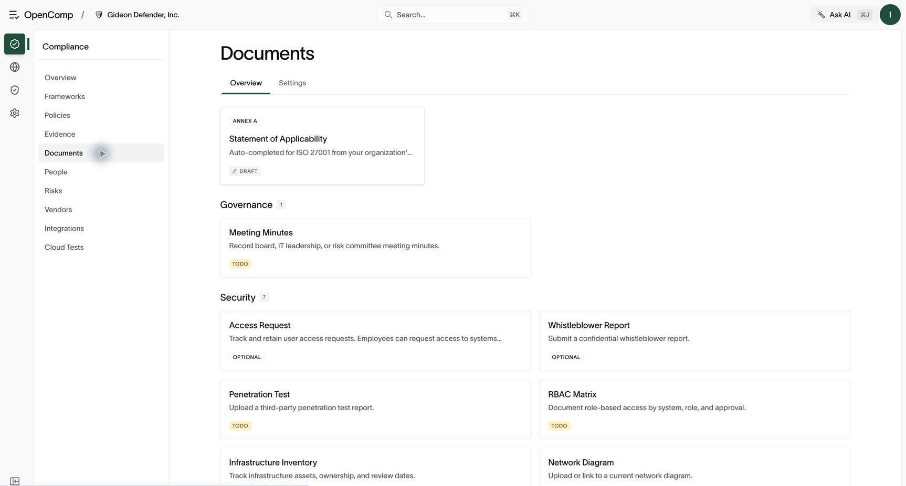

# Documents and ISMS

Requires `evidence:read` to view. Editing ISMS content requires
`evidence:update`.

## Company forms

Open **Compliance → Documents → Overview** for document categories.
Available records include meeting minutes, access requests, third-party
penetration test reports, an RBAC matrix, infrastructure inventory, network
diagrams, tabletop exercises, and employee performance evaluations. Open
a document type to view its records and the available submission form.
Use **Settings** to review document configuration.

*Open a document card to work with that record type.*

These records feed auditor views and generated documents — keep them
accurate and current.

## ISO 27001 ISMS

If the ISO 27001 framework is active, **Documents** includes an ISMS
section: the management-system documents mapped to ISO clauses.

1. Run the **ISMS wizard**: scoped questions about the company, services,
   vendors, headcount, and leadership.
2. Review the generated documents per ISMS type.
3. Map them to controls and publish alongside policies.

## Record a document

1. Choose the document type that matches your evidence.
2. Complete the displayed required fields and attach the supporting file or
   link where requested.
3. Save or submit, then verify the new entry appears in that type’s list.
4. Reopen the entry to check dates, owners, and attachments before using it
   as audit evidence. Use a third-party report document for an existing
   pentest report; starting an OpenComp scan is a separate workflow.

## Statement of applicability

Open **Documents → Statement of Applicability**. The statement records, control by control, whether each
control applies and why. It is a first-class audit artifact — review it
before every audit, not after the auditor asks.
