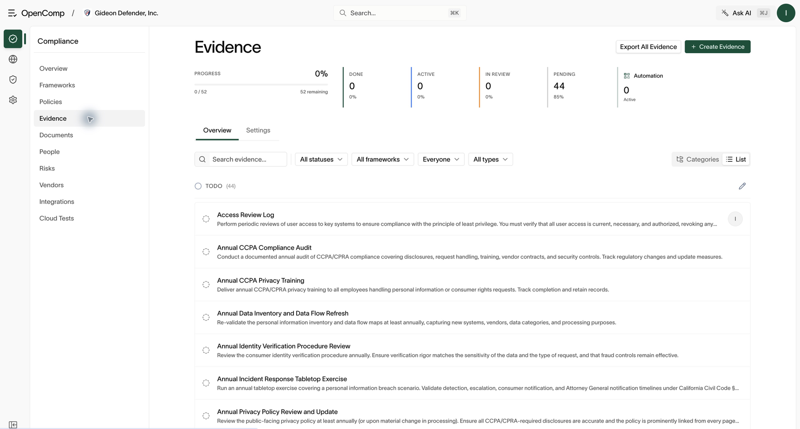
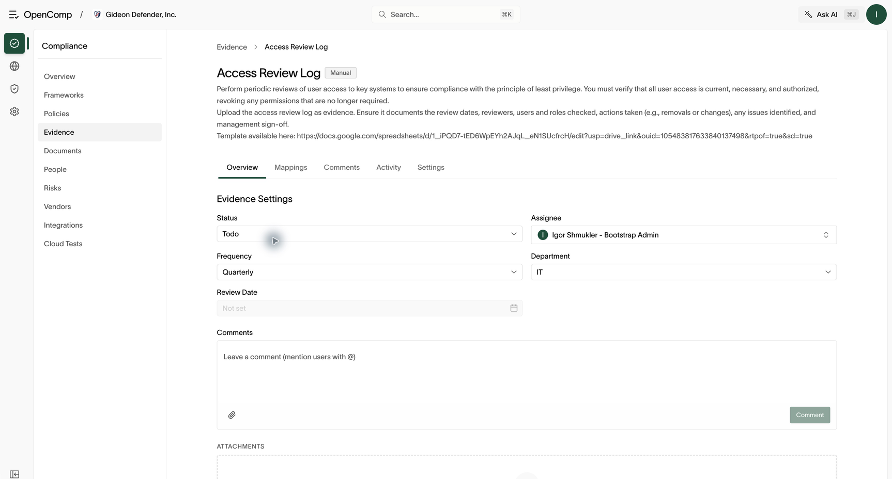

# Evidence and tasks

Requires `evidence:read` or `task:read` to view. Creating and completing
work requires task permissions; exports and approvals depend on your
organization's settings.

## Concepts

- A **task** is a unit of compliance work (for example "Collect Q3 access
  review evidence"), assigned to a person and linked to controls.
- **Evidence** is the proof attached to a task: files, links, or data synced
  automatically from connected integrations.
- Some tasks run **automations** that collect evidence on their own and
  report success or failure.

## Work a task

1. Open **Compliance → Evidence**. Some deployments use the label **Tasks**.
2. Use the category or list view; filter by assignee, control, or framework.
3. Open a task to see its description, linked controls, assignee, and due date.
4. Attach evidence or confirm the automation's run results.
5. Mark the task done. If your organization requires approvals, an approver
   confirms before it counts.

*Filter by status, framework, assignee, or type; switch between Categories and List.*

*Use Overview to manage work, Mappings to check controls, and Activity to review changes.*

## Attach and verify evidence

1. On the task’s **Overview**, use the attachment area to upload proof.
   The displayed limit is 100 MB per file.
2. Wait for the upload to finish and check that the attachment appears.
3. Add a comment describing the period covered, source, reviewer, and any
   exceptions. Keep passwords and API keys out of comments and files.
4. Set the appropriate status and confirm it remains after reopening the task.

If an upload fails, check its size and retry after restoring connectivity.
Do not mark work complete until the required proof is available.

## Assignees

Assignees must have app access (`app:read`). Portal-only employees cannot be
assigned compliance tasks — assign their manager or the control owner.

## Automations

Automated evidence tasks run on a schedule and record each run with a status
and evaluation result. A failed run needs attention like any overdue task:
open it, read the evaluation, fix the underlying gap or the automation's
configuration.

See [Browser automations](browser-automations.md) for recurring screenshots
from vendor websites.

## Export evidence

Use **Export All Evidence** on the Evidence page when permitted. Choose
the offered export option and wait for the download to finish. Open the
result and check the required reporting period and attachments before
sharing it. Exports can contain confidential material.

If permitted, export evidence packs for auditors. Exports include the
evidence plus its linkage to controls, which is what an auditor needs to
rely on it. Auditors can also self-serve exports from the read-only
[Auditor view](#auditor-view).

## Auditor view

The **Auditor** section is a read-only view built for external auditors:
organization context, frameworks, controls, and evidence, plus an evidence
export button. Nothing there can be changed. Access requires the auditor
role (or a custom role with explicit `audit:read`).
