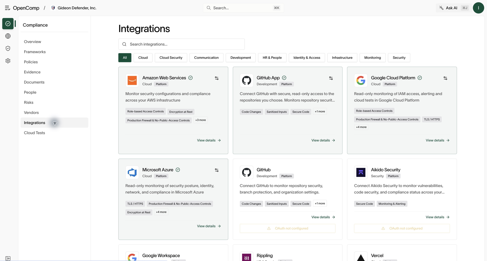

# Integrations

Connect third-party tools so OpenComp syncs users, evidence, and security
data automatically. Requires `integration:create` to add, `integration:update`
to configure and scan, `integration:delete` to remove.

## Browse and connect

1. Open **Integrations** for the catalog with per-provider status.
2. Open a provider for its detail view: connection status, accounts, and
   services using it.
3. Click **Add** (or **Connect**) and follow the provider setup. OAuth
   providers redirect for authorization; key-based providers (like AWS)
   need credentials or a role created with the exact values shown.
4. Missing required values open a **Configure** dialog — saving triggers an
   initial sync.

*Open a provider card to review its services and connection options.*

If **OAuth not configured** appears, your system administrator must configure
the provider before connection is possible. Repeatedly signing in will not
resolve a missing provider configuration.

## Multiple accounts

Providers that support it (AWS, GCP, Azure) hold several connections. Switch
accounts with the account selector; add more with **Add**. Each account has
independent credentials, regions, and settings.

## Manage an account

Open **Settings** for the selected account:

- Update credentials, regions, and provider-specific options.
- Review status, last sync, and which services consume the connection.
- **Disconnect** to remove the account (danger zone, with confirmation).
  Historical data stays for the audit trail. See [Cloud security](cloud-security.md)
  for the cloud-account walkthrough.

## Confirm connection health

After connecting, verify the account is listed and inspect its latest sync
or scan. Confirm the expected account and services are selected. A connected
account with zero results is not evidence that every check passed: check the
sync time, enabled services, and permission errors.

## Evidence flow

Connected tools feed evidence tasks automatically (see
[Evidence and tasks](evidence-and-tasks.md)) and access reviews (see
[People](people.md)). If an integration shows errors, open its detail view:
sync status and error panels name the cause (expired OAuth, missing
permissions, changed credentials). Reconnect or repair credentials, then
re-run the affected tasks.

## Practical guidance

- Connect with a dedicated service identity, not a personal account, so
  access survives turnover.
- Reconnect promptly on expiry — stale integrations silently stop producing
  evidence.
- Remove connections you no longer use; every live credential is attack
  surface.
