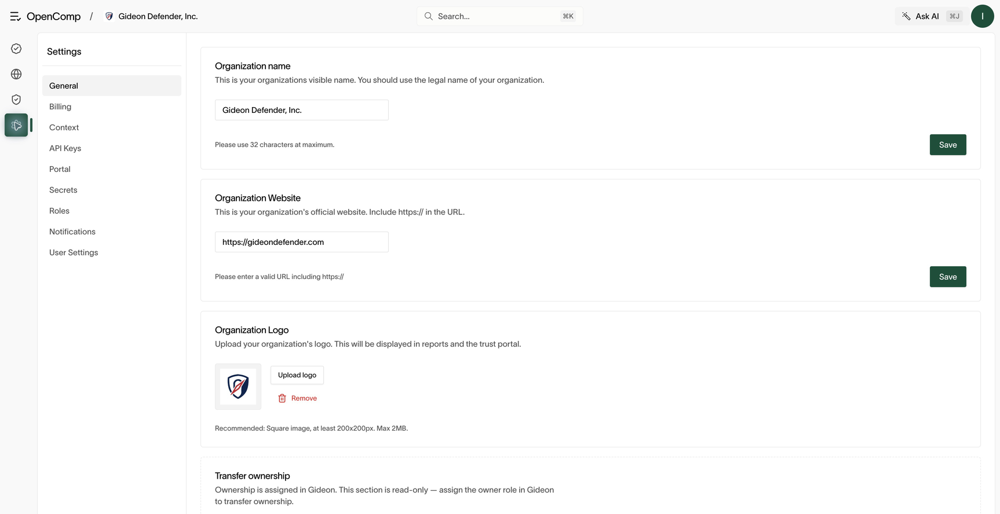
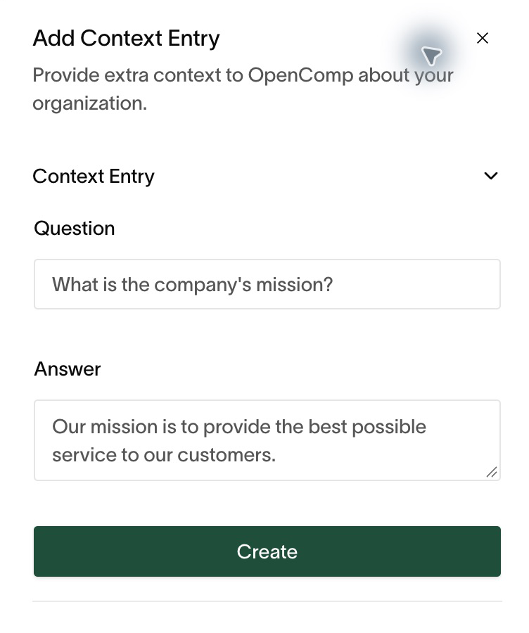
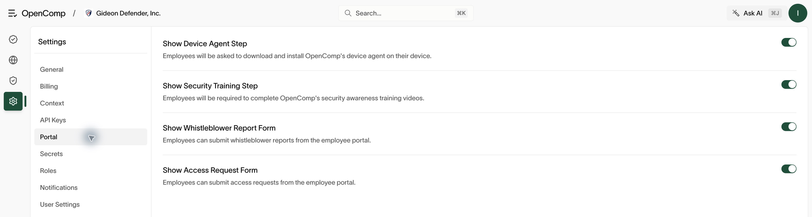

# Organization settings

**Settings** holds organization configuration. Most sections require owner
or admin; the page shows only what your role permits.

## General

Update the organization name, website, and logo. Ownership transfer and
organization deletion live here too:

- **Transfer ownership** is read-only guidance — ownership is assigned in
  Gideon (see [Roles and access](roles-and-access.md)).
- **Delete organization** permanently removes everything. This cannot be
  undone.

*Save each changed section and reopen it to confirm the value. Ownership assignments live in Gideon.*

## Billing

Plans, add-ons, invoices, usage, and payment method. Keep a current payment
method — metered features (penetration tests, background checks) require it.

## Context

Open **Settings → Context** to maintain facts about your organization.
Search existing entries before choosing **Add Entry**. Enter a clear
question and a factual answer, then create the entry and verify it appears
in the list. These facts support AI features, so update them when your
systems, services, or responsibilities change. Do not store credentials here.

*Keep each entry specific enough to review and reuse.*

## Roles

The roles table is read-only: role content ships with the product and
assignments live in Gideon. Custom role definitions appear here for
reference. No local role actions exist.

## API keys

Requires `apiKey:create,read,delete` (owners/admins).

1. Open **API Keys → Add API Key**. Enter a name and expiration. Choose
   **Read Only** or **Custom** for the minimum permissions needed; review
   the selected count before creating the key.
2. Copy the key immediately — it is shown once.
3. **Revoke** keys you no longer use or that may have leaked.

Use keys as the `x-api-key` header for API automation. See
[Automation and API access](automation-and-api.md) for key handling and MCP.

*The form initially selects broad access; choose the permissions deliberately before creation.*

## Secrets

Requires `secret:*` (owners/admins; auditors excluded).

Store credentials OpenComp needs (integration keys and similar) with a name,
value, category, and description. Values decrypt only on reveal, one row at
a time. Edit or delete secrets you rotate. Never paste secrets into tasks,
policies, or chat.

## Notifications

Per-role notification settings: who gets told about what. Review after role
changes so alerts reach the right people.

## Portal

Use **Settings → Portal** to control the device-agent and security-training
steps and the whistleblower and access-request forms. Confirm the employee
experience after changing these options. See [Employee portal](employee-portal.md).

*These options determine which steps and forms employees see.*

## Browser connections

Connections used by browser automation: password-based (renewable) vs SSO
(which can't be renewed unattended). Renew before expiry or automations
stall.

## Your preferences

Under **User**: login email display, email notification preferences, and
organization selection for API/MCP use.
