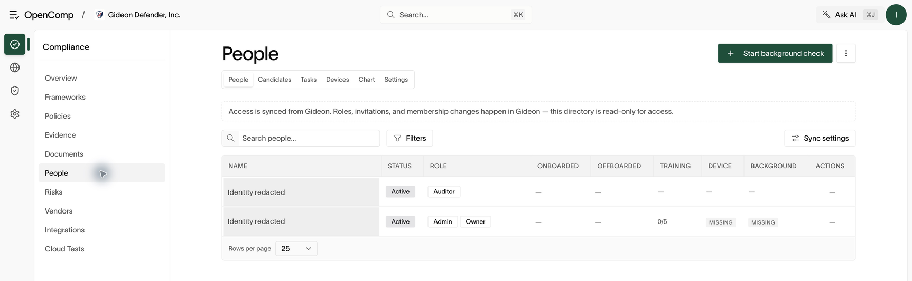

# People

The directory, employee records, onboarding, offboarding, and training.
Profile data syncs from Gideon and is read-only in OpenComp — see
[Roles and access](roles-and-access.md).

## Directory

**People** shows members, pending (historical) invitations, compliance
completion, devices, the org chart, and settings as tabs. Filter by
onboarding/offboarding dates, role, and requirement columns.

Tabs:

- **People** — member list with requirement status per person.
- **Candidates** — background-check screenings (see
  [Background checks](background-checks.md)).
- **Tasks** — per-person completion of policies and training.
- **Devices** — device coverage (see [Devices](devices.md)).
- **Chart** — reporting structure.
- **Settings** — background-check toggle and offboarding checklist template
  (owners/admins).

Historical invitations are shown read-only. New access is granted in
Gideon, never by inviting from OpenComp.

*Access changes sync from Gideon. Use the directory to review compliance completion.*

## Employee record

Open an employee for tabs: details (read-only profile), policies (signature
status), training, HIPAA training (if applicable), device, access
(per-integration access), background check, and offboarding (appears once an
offboard date is set).

## Onboarding

Onboarding happens in Gideon (account + role assignment), which syncs the
person into the directory. In OpenComp, verify the person appears, assign
required policies and training, and order a background check if your process
requires one.

## Offboarding

1. Set the member's **offboard date**. An **Offboarding** tab appears.
2. Work the offboarding checklist: revoke integration access, collect
   devices, disable accounts. Checklist items can require evidence.
3. The access tab shows per-integration access so nothing is missed.
4. Export the offboarding record for the personnel file.

Use device-agent revocation controls where available. Removing a device
session does not disable the employee’s identity or revoke access to every
third-party service. Confirm those actions separately.

## Confirm onboarding and offboarding

For onboarding, verify the expected person and role in **People**, then
check the policy, training, device, and background-check requirements that
apply. For offboarding, confirm access removal in Gideon and each connected
service, and retain evidence against the checklist. A date on a profile
alone is not proof that accounts were disabled.

If **Candidates** cannot load, retry once and ask your administrator to
check the Checkr integration. Avoid repeated screening submissions while
the status of an earlier request is unknown.

## Training

Training videos and HIPAA training are taken by employees (see
[Employee portal](employee-portal.md)) and tracked here per person, with
completion certificates available for download. The Tasks tab aggregates
completion across the organization — use it to chase stragglers before an
audit.
