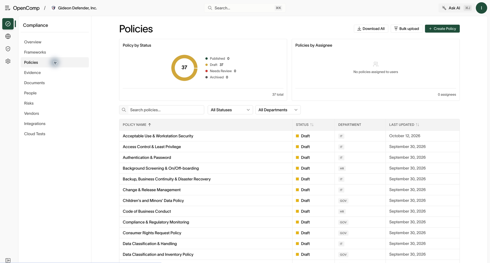
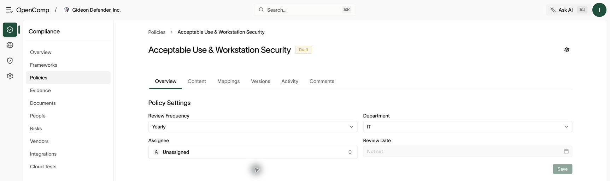

# Policies

Requires `policy:read` to view. Creating requires `policy:create`; editing,
publishing, regenerating, and approving require `policy:update`; deleting or
archiving requires `policy:delete`.

## Policy list

**Policies** shows charts by status (draft, in review, published, archived)
and a filterable table. While AI generation is running, a banner reports
that policies are being tailored.



*Use status and department filters to identify policies that need review.*

## Create a policy

- **Create Policy** — start from scratch or a template.
- **Bulk upload** — attach a PDF to an existing policy.
- **Regenerate all policies** — AI-draft the full set for your frameworks.

## Policy lifecycle

```text
draft → in review (Submit for approval) → published → (new versions, archive)
```

1. Edit the draft in the built-in editor.
2. Assign an approver and **Submit for approval**.
3. The approver reviews and approves.
4. **Publish** a version. Publishing makes the policy count toward framework
   coverage and makes it visible to employees.
5. Later changes go through **Create Version** so history is preserved.
6. Retired policies are archived or deleted.

Open a policy for **Overview**, **Content**, **Mappings**, **Versions**,
**Activity**, and **Comments**. In **Overview**, set the assignee, department,
review frequency, and review date; choose **Save** when available. In
**Content**, select the version and use **Editor View** or **PDF View**.



*Overview holds policy metadata; Content holds the text or PDF.*

## AI policy editor

The policy editor includes an AI assistant that can draft sections, suggest
edits inline, and propose changes as reviewable cards you accept or reject.
Good AI output depends on published policies and knowledge-base context —
see [Security questionnaires](questionnaires.md).

## Control mappings

Each policy maps to one or more controls. Mappings drive framework scores:
a control with a published, mapped policy counts as covered. Review mappings
when frameworks update.

## Approvals

Follow the approval flow shown for the selected version. When an approver
is required, select the reviewer and submit that version for approval.
Review pending changes before publishing. Keep **Versions** and **Activity**
as the record of what was reviewed and published; a draft saved in the
editor is not yet a published policy.

## Confirm publication

Return to the list and check the policy status. Reopen **Content** and
**Versions** to verify the intended version is published. If editing is
blocked, check whether that version is awaiting approval. If employees
cannot see the policy, verify publication and their organization access.

## Practical guidance

- Publish before an audit — only published policies count for coverage and
  employee attestation.
- Version, don't overwrite — auditors ask what the policy said at a point in
  time.
- Keep control mappings current after framework version updates.
