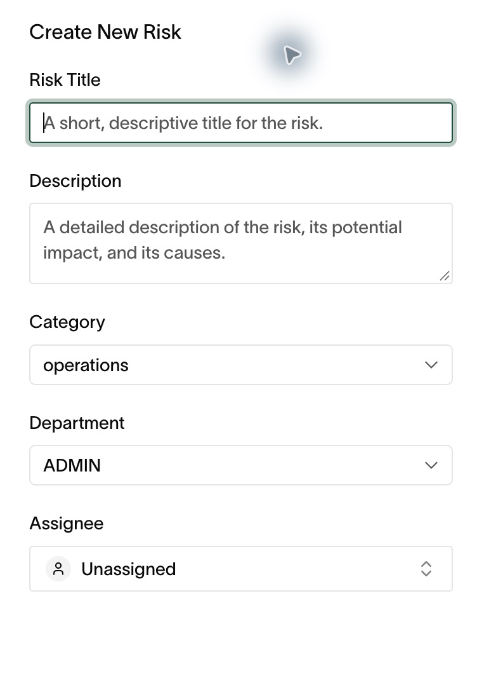
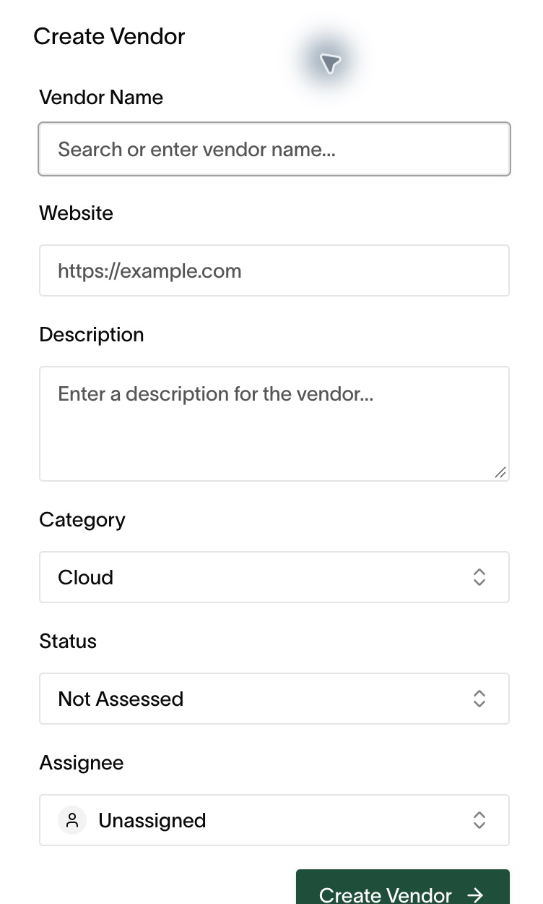

# Risk and vendors

## Risk register

**Risk** lists organizational risks with title, description, category,
department, status, likelihood, impact, residual likelihood/impact, treatment
strategy, and assignee.

1. Open **Compliance → Risks**. Search by title or filter by severity, status,
   and owner.
2. Choose **Create Risk**. Enter a title and description, then select category,
   department, and assignee. Create the record, then open its details to
   assess likelihood, impact, and treatment.
3. Open a risk for its remediation tasks. Completing the tasks is what
   reduces residual risk — update the residual scores when done.
4. Revisit accepted risks on a schedule; acceptance is a decision with an
   expiry, not a permanent state.

Risk ownership actions are limited to owner/admin/custom roles.

*Describe the risk and assign responsibility before assessing its treatment.*

## Vendor register

**Vendors** lists third-party vendors with risk context.

1. Open **Vendors** and review the register.
2. Choose **Add Vendor** to open **Create Vendor**. Enter the name, website,
   description, category, assessment status, and assignee for the third party.
3. Open a vendor to review its details, run an assessment review, and track
   follow-up tasks per vendor.
4. Record assessment outcomes on the vendor — they feed audit evidence and
   the Trust Center's vendor list.

*Use Not Assessed until you have completed the review and recorded its outcome.*

## Confirm your review

Reopen the saved risk or vendor. Check the owner, status, scores, and review
notes. Record why treatment reduced the residual risk; completing a task
does not by itself demonstrate that the risk has fallen.

## Practical guidance

- Score honestly. A register full of low risks nobody believes is worse than
  a short register with three real ones.
- Tie every high risk to tasks with owners and dates.
- Review vendors when contracts renew, not only when onboarding.
- Use [Security questionnaires](questionnaires.md) to prepare answers about
  your own organization. Keep vendor assessment conclusions in the vendor record.
