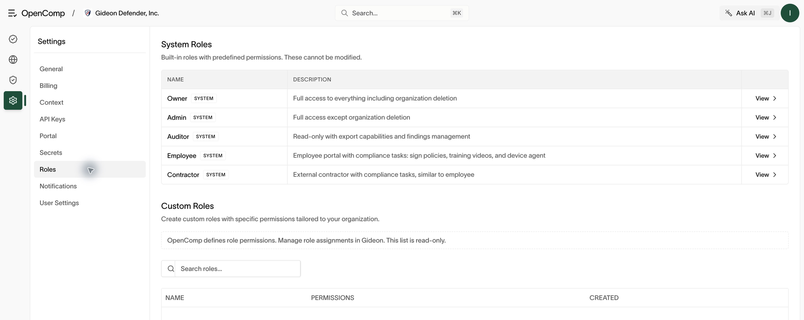

# Roles and access

## The one rule

**Roles are defined in OpenComp and assigned in Gideon.** Admins create custom
roles under Settings → Roles; Gideon decides who holds them. OpenComp never
assigns roles to people — login overwrites assignments on every sign-in and on
a five-minute reconciliation schedule.

What this means in practice:

- To define what a role can do: create or edit it in OpenComp (Settings →
  Roles). A new role alone grants nobody access.
- To give someone access: assign them the role name in Gideon (exact
  case-sensitive match — `Lead` is not `lead`).
- To remove someone: remove the assignment in Gideon (and offboard them —
  see [People](people.md)).
- To change a role: edit permissions in OpenComp for immediate enforcement;
  change assignments in Gideon for who holds it.
- A user with no Gideon entitlements cannot sign in at all.
- Renaming a role orphans holders until Gideon values are renamed to match;
  deleting is blocked while members hold the role.

## Built-in roles

| Role | Intended for | Key abilities |
| --- | --- | --- |
| Owner | Company owners | Everything, including deleting the organization |
| Admin | Security/compliance leads | Everything except deleting the organization |
| Auditor | External/internal auditors | Read everything, raise and manage findings; no secrets, no API keys |
| Employee | Staff | Employee portal only (own policies, training, tasks, devices) |
| Contractor | Contractors | Same portal-only scope as employee |

Custom roles can contain only permissions that their creator can grant. The Write
option selects the actions that the caller holds for each resource.

Built-in permissions stay fixed. The Auditor role cannot require compliance
because it lacks portal access. Use a custom role with compliance enabled when
an auditor also needs to complete employee compliance work.

*Use New/View to define permissions; change assignments in Gideon.*

## Permissions

Permissions use a `resource:action` format (for example `policy:update`,
`control:read`, `pentest:create`). The resources include:

`organization`, `member`, `control`, `evidence`, `policy`, `risk`, `vendor`,
`task`, `framework`, `audit`, `finding`, `questionnaire`, `integration`,
`apiKey`, `trust`, `pentest`, `app`, `compliance`, `training`, `portal`,
`secret`, `backgroundCheck`.

Notable gates:

- `app:read` — enter the main app at all. Portal-only roles lack it.
- `integration:create` / `update` / `delete` — add, run/scan, and remove
  connections.
- `backgroundCheck:create` — start screenings; `backgroundCheck:read` — view them.
- `secret:*` — manage decrypted credentials (owners/admins only; auditors
  are excluded).
- `apiKey:*` — create and revoke API keys.

Permissions are action-specific; a read permission does not authorize
creating or changing records. See [Automation and API access](automation-and-api.md)
for scoped credentials.

## Sessions and authentication

- Interactive users sign in with Gideon SSO (sessions).
- Automation can use API keys (`x-api-key` header), created in
  **Settings → API Keys**. An API key's abilities equal the scopes selected at
  creation. Keys are shown once — store them securely.
- When access is revoked in Gideon, OpenComp sessions stop working at the
  next reconciliation run (about five minutes), not only at next login.

## If you cannot see something

1. Check your role with an admin.
2. Check the permission listed at the top of the relevant guide.
3. If the whole app says "No access", your role lacks `app:read` — you are
  probably a portal-only user; use the [Employee portal](employee-portal.md).
