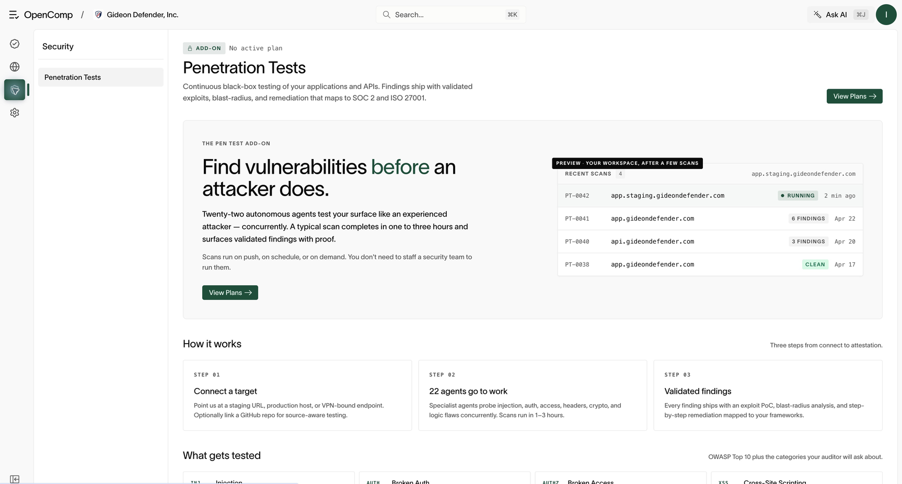

# Penetration tests

Requires `pentest:read` to view and `pentest:create` to start tests. Your
organization also needs the penetration-testing feature and available allowance.
If you see **No active plan**, ask the organization’s billing administrator
to enable the appropriate plan before continuing.

*This is the subscription entry screen. The example scans shown on it are previews.*

## Run a test

1. Open **Security → Penetration tests**.
2. Open the new-run action and enter the target (a URL or domain you own), plus context
   about the target.
3. Pick a scan profile:
   - **Quick** (about 5–15 minutes) — discovery, secrets and info
     disclosure, technology configuration. Report only.
   - **Standard** (about 30–90 minutes) — the full check set except race
     conditions and business logic. Safe proof of findings.
   - **Deep** (2–8+ hours) — all checks, including impact proof.
   - **Custom** — choose checks and evidence level yourself.
4. Review the expected runtime, tick the authorization consent (you must own
   the target), and start the run.
5. Watch progress live: agent activity, per-check progress, and severity
   counts.

## Read the results

- **Findings table** — every finding with severity. Open one for detail,
  affected location, and context.
- **Report view** — a clean, shareable report (cover, executive summary,
  details). Share it with engineering or leadership.
- **Failed runs** — open the failure detail; fix the target/config issue and
  re-run.

## Confirm completion

A running scan is not a final assessment. Wait for completion, open the
report, and verify target, scope, assessment dates, and findings. A failed
run or unreachable target is not a clean result. Runtime estimates vary by
target and selected profile.

## Remediation workflow

1. Triage by severity: fix critical and high findings first.
2. Assign each finding to an engineer with a due date in your team’s work tracker.
3. Re-test after the fix to confirm closure.
4. Keep reports as audit evidence for the relevant controls.

## Rules

- Only test targets you own or are authorized to test. The consent checkbox
  is a legal attestation, not a formality.
- Start with Standard. Use Deep for pre-release or high-risk systems, Quick
  for rapid checks during development.
