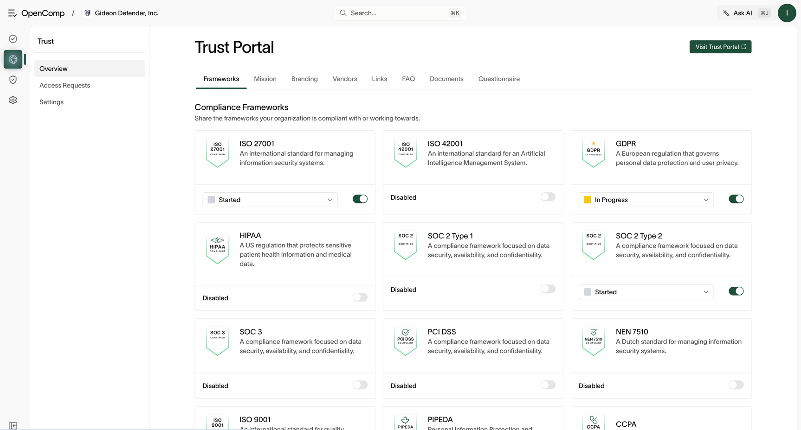
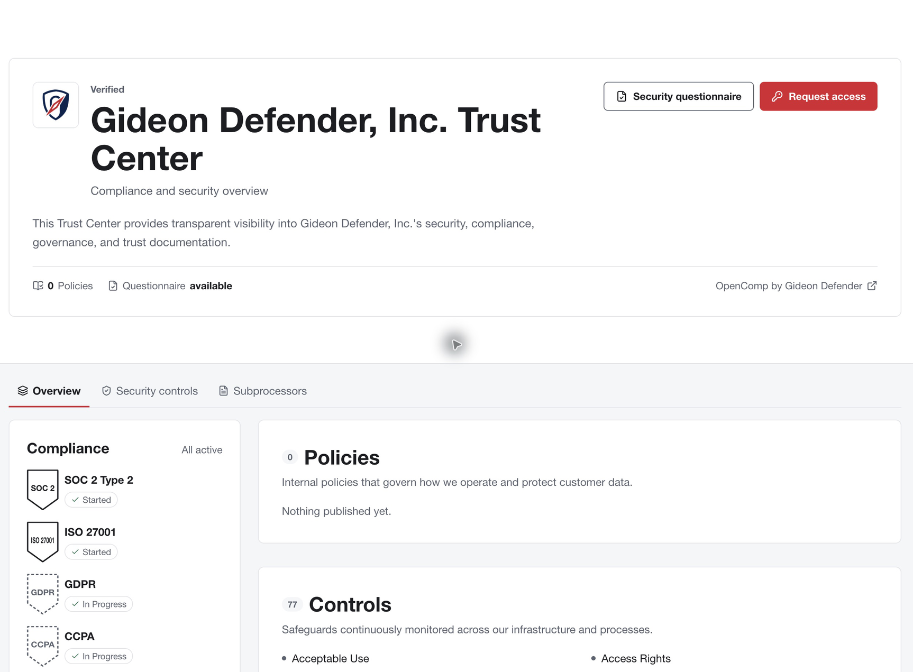
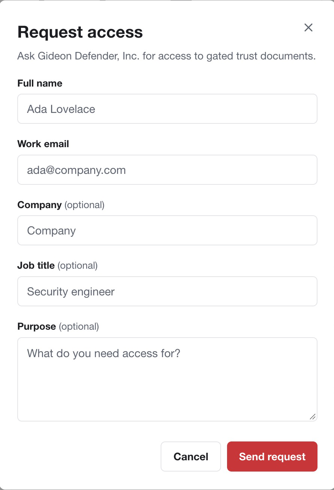
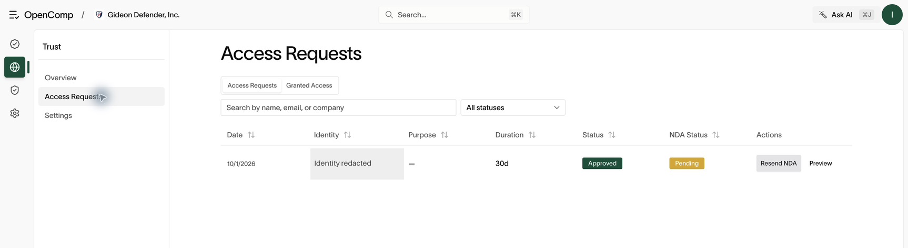

# Trust Center

Requires `trust:read` to view configuration and `trust:update` to change it.

## Public portal

The Trust Center is a public page for customers and prospects:
compliance posture, certifications, documents you choose to share, FAQs,
vendors, and a security questionnaire entry point.

1. Open **Trust** and enable the portal.
2. Set the URL (friendly slug or custom domain), contact email, branding,
   and overview content.
3. Toggle which frameworks and certifications to show, upload certificate
   files, and add documents, links, vendors, and FAQs.
4. Use **Visit Trust Portal** to open the public view and verify the content.
   This button opens the portal; it is not a separate publish action.

*Use the content tabs to manage frameworks, mission, branding, vendors, links, FAQ, documents, and questionnaires.*

## What a visitor sees

*The public page distinguishes framework progress from completed certification
and shows published policies, controls, and subprocessors.*

Visitors can use **Overview**, **Security controls**, and **Subprocessors** to
explore the content you expose. If no policies are published, the portal
shows an empty policy section. Publish and review the intended materials
before directing customers to them.

## Request access as a visitor

1. Open the organization’s Trust Center and choose **Request access**.
2. Enter your full name and work email. Company, job title, and purpose are
   optional fields in the request form.
3. Choose **Send request**, then follow the access and NDA instructions you
   receive. Submission requests review; it does not grant immediate access.

*Use your work identity so the organization can assess the request.*

If **Security questionnaire** opens the same request form, it pre-fills the
purpose as “Security questionnaire.” Complete the request for the team to
review; this entry point does not directly display the internal questionnaire
workspace.

## Access requests and NDAs

Visitors can request access to gated materials:

1. Requests land in **Trust → Access requests** as under review.
2. **Approve & Send NDA** sends the NDA; **Deny** declines with a record.
3. Track NDA status per request; resend if it stalls.
4. Approved visitors appear under grants. **Revoke** ends access.
5. Skip the NDA step for trusted domains or email addresses via the NDA
   bypass list in settings.

*Approval and NDA status are separate. Check both before expecting a visitor to reach gated content.*

## Confirm visitor access

Open the public portal and check framework wording, visible documents,
branding, and contact information. “Started” and “In Progress” describe
work underway; they should not be presented as completed certifications.
For gated access, inspect the request’s NDA state and the **Granted Access**
tab. Use **Preview** where offered to inspect the request’s NDA.

## Practical guidance

- Publish the Trust Center before evaluators ask — proactive transparency
  shortens security reviews.
- Gate sparingly: public artifacts (certifications, pen-test summary) build
  trust; gate customer lists, detailed reports, and anything with
  customer names.
- Review grants quarterly and revoke stale ones.
- Keep the questionnaire toggle aligned with reality: if it promises answers,
  someone must answer them (see [Security questionnaires](questionnaires.md)).
