# OpenComp User Manual

*Reference for the OpenComp compliance app, employee portal, Trust Center, security product, API/MCP, browser extension, and device agent. The illustrated walkthroughs below use the live development workspace viewed in Chrome on October 17, 2026. Availability depends on permissions, plans, deployment settings, and feature flags.*

## How to use this manual

- **Permission names** (`resource:action`) appear next to gated actions. If an action is unavailable, ask an owner or admin to check both your permissions and feature availability. Access itself is granted in **Gideon** (your identity provider) — never inside OpenComp.
- **Plan/feature gates** are stated explicitly (subscription add-on, PostHog feature flag, deployment option). A missing feature is not always a permissions problem.
- **Success checks** tell you how to confirm work was saved. Never treat a draft, an empty scan, or an incomplete sync as completion.
- Deep-dive pages under `docs/user-guide/` remain the best starting point for the most common flows; this manual is the exhaustive reference.

## About the screenshots

All 43 screenshots in this manual were captured from OpenComp, Gideon Cockpit, and the Google authorization flow in the existing Chrome tab on **October 17, 2026**. They show the **Gideon Defender, Inc. development workspace**, the Gideon OIDC application configuration, and the Google screens used to reconnect GCP. Browser tabs and the address bar were cropped out; configuration panels were cropped to the relevant area. Full-page captures were reduced to half resolution for readability; the focused Gideon access-policy crop retains its original resolution. Personal identities in the Gideon access-policy view were excluded by cropping. No image came from the internet, an existing image library, or a generated mockup. Names, email addresses, and avatar initials in the People directory screenshot are obscured for privacy; the rest of that screenshot is unchanged. Google account-picker names, email addresses, and avatars are also blurred, as is the account identity in the Google verification screenshot. [Capture records](images/manual/captures.json) list each product path and image checksum.

The captures show this workspace's actual data and availability, including empty lists, unavailable features, and errors. Names, counts, scores, and dates are examples rather than targets for your organization. Open an image at full size if table labels are hard to read.

The live navigation did not expose Timeline, the ISMS workspace, Questionnaire/Knowledge Base, or Browser connections. Their reference sections describe conditional features; there are no screenshots of those unavailable views. The employee portal, browser extension, device agent, and public Trust Portal were outside this capture tour.

## Table of contents

1. [Start here: accounts, sign-in, organizations, navigation](#1-start-here)
2. [Roles and permissions (full)](#2-roles-and-permissions), including [Gideon IdP configuration](#identity-provider-configuration-gideon)
3. [Settings (every section)](#3-settings)
4. [Overview dashboard](#4-overview-dashboard)
5. [Findings](#5-findings)
6. [Compliance timeline](#6-compliance-timeline)
7. [Frameworks (platform and custom)](#7-frameworks)
8. [Policies](#8-policies)
9. [Evidence and tasks](#9-evidence-and-tasks)
10. [Task automations](#10-task-automations)
11. [Documents and evidence forms](#11-documents-and-evidence-forms)
12. [ISO 27001 ISMS](#12-iso-27001-isms)
13. [Statement of Applicability](#13-statement-of-applicability)
14. [Risk register](#14-risk-register)
15. [Vendor register](#15-vendor-register)
16. [People directory](#16-people-directory)
17. [Employee records](#17-employee-records)
18. [Offboarding](#18-offboarding)
19. [Background checks](#19-background-checks)
20. [Devices and the device agent](#20-devices-and-the-device-agent)
21. [Org chart](#21-org-chart)
22. [Penetration tests](#22-penetration-tests)
23. [Cloud security tests](#23-cloud-security-tests)
24. [Integrations](#24-integrations)
25. [Security questionnaires](#25-security-questionnaires)
26. [Knowledge Base and Context Hub](#26-knowledge-base-and-context-hub)
27. [Browser extension](#27-browser-extension)
28. [Trust Center (admin)](#28-trust-center-admin-surfaces)
29. [Trust Center (public portal and grants)](#29-trust-center-public-portal-and-grants)
30. [Auditor view](#30-auditor-view)
31. [Ask AI assistant](#31-ask-ai-assistant)
32. [Email, notifications, preferences](#32-email-notifications-preferences)
33. [Automation and API access (API keys, MCP)](#33-automation-and-api-access)
34. [Employee portal (complete)](#34-employee-portal-complete)
35. [Platform flows (sign-up, setup, upgrade, referrals)](#35-platform-flows)
36. [Troubleshooting](#36-troubleshooting)
37. [Reference: permissions, flags, limits](#37-reference)

---

# 1. Start here

## What OpenComp is

OpenComp runs your compliance and security programs in one place. It has distinct surfaces:

| Surface | What it holds | Who uses it |
|---|---|---|
| **Compliance app** (this app) | Frameworks, controls, policies, evidence, documents, ISMS, risks, vendors, people, settings | Admins, compliance leads, auditors |
| **Security product** (within the app) | Penetration tests, cloud security tests, integrations | Security engineers |
| **Trust Center** | Public transparency site + customer access requests/NDAs | Your customers, prospects, auditors |
| **Employee portal** (separate app) | Policies, training, device agent, forms | Every employee/contractor |
| **Auditor view** | Read-only audit workspace | External/internal auditors |
| **Device agent** | Laptop/compliance telemetry | Installed on endpoints |
| **MCP / API / browser extension** | Automation surfaces | Agents, scripts, questionnaire answerers |

## Signing in

OpenComp uses SSO through the Gideon identity service; there are no OpenComp passwords.

1. Go to your OpenComp URL, choose **Continue with Gideon**, and complete sign-in.
2. If you have memberships in several organizations, OpenComp activates the one you last used or the one encoded in the link you opened.
3. If sign-in says you have no access, your Gideon account has no entitlement for this organization — ask an administrator to assign you in Gideon.
4. If the whole app shows **No access**, your role lacks `app:read` (typical for portal-only roles — use the **Employee portal** at your portal URL). The No-access page links to the portal.

Changing an organization ID in a URL does not grant cross-tenant access; tenants are enforced server-side on every request, including for API keys and MCP tokens.

## Navigation

The app shell has a **product rail** and a **sidebar**:

- **Compliance sidebar** — visible when you hold read permission on any compliance segment (`framework:read`, `policy:read`, `evidence:read`/`task:read`, `member:read`, `risk:read`, `vendor:read`, `integration:read`, …). It contains: Overview, Frameworks, Auditor (auditor-view rule), Policies, Evidence, Documents, People, Risks, Vendors, Questionnaire (feature flag), Integrations, Cloud tests. Open controls through a framework or an existing control link (see §7).
- **Trust rail** — visible with `trust:read`. Holds Trust Center configuration and access requests.
- **Security rail** — visible with `pentest:read` (and the security feature enabled). Holds Penetration tests; the Security sidebar shows one item: Penetration Tests.
- **Settings rail** — hidden from auditor-only users. Holds all Settings pages.

Use **Search** (⌘K) to find work anywhere. Documents are reachable from links on the Overview and from Compliance navigation; there is a Documents route for every deployment.

## The one rule of access

Roles are **defined** in OpenComp (Settings → Roles) and **assigned** in Gideon. OpenComp never assigns roles to people: assignments are overwritten at every sign-in and on a ~5-minute reconciliation schedule. Renaming a role in OpenComp orphans its holders until the Gideon assignments are renamed to match; deleting is blocked while anyone holds the role. Removing a user's Gideon entitlement stops their sessions at the next reconciliation run, not only at next login.

---

# 2. Roles and permissions

Requires `ac:read` to view, `ac:create`/`ac:update`/`ac:delete` to manage (these are the "access control" permissions).

## Identity provider configuration (Gideon)

This walkthrough is for the administrator who connects OpenComp to Gideon and manages application access. You need permission to administer applications and entitlements in Gideon; a deployment administrator applies OpenComp's server settings. Define any custom roles in **OpenComp → Settings → Roles** before mapping them in Gideon.

The screenshots show the development integration. Use your own environment's issuer, client ID, public callback URL, and organization ID when configuring another deployment.

### Open the OpenComp application in Gideon

In **Gideon Cockpit → Security & Access → Applications**, find **OpenComp** and select **Details**. Check that its protocol is **OIDC** and its status is **Active**. For a new deployment, register a separate OIDC application using **Add application** and record its generated client ID.

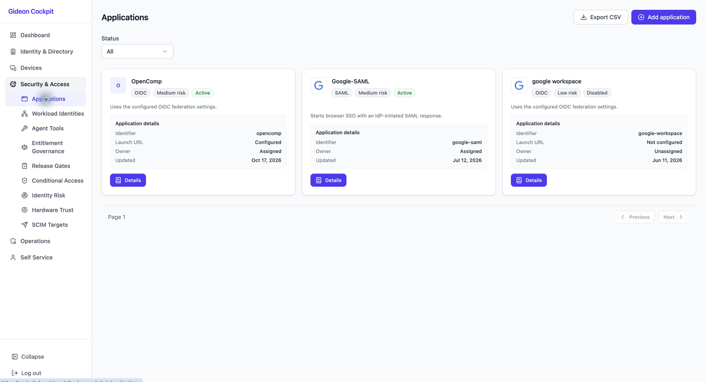

*Security & Access → Applications is the administrator's configuration view.*

The application's setup assistant links to OIDC configuration, access policy, diagnostics, setup export, and the smoke test. Work through these areas before handing the integration to users.

### Configure the OIDC client

Review **OIDC configuration** and select **Edit** when changes are needed. The captured integration uses these settings:

| Setting | Example or selection | What to check |
|---|---|---|
| Client ID | Copy the ID generated for this application | OpenComp must use this application's ID; the display name `OpenComp` is not the client ID. |
| Redirect URI | `https://opencomp.dev.gideondefender.com/v1/auth/oidc/callback` | Register the exact public URL routed to OpenComp's API callback, including scheme, hostname, and path. |
| Scopes | `openid profile email` | Keep OpenID enabled and request profile and email. The captured client does not select Offline access. |
| Grant types | Authorization code; Refresh token | The browser sign-in flow uses the authorization code grant with PKCE. |
| Client secret | None for this public client | Gideon explicitly states that public clients do not use client secrets. |
| Launch URL | `https://opencomp.dev.gideondefender.com/v1/auth/oidc/login` | Launch into OpenComp's login entry point so it creates the sign-in request and callback state. |

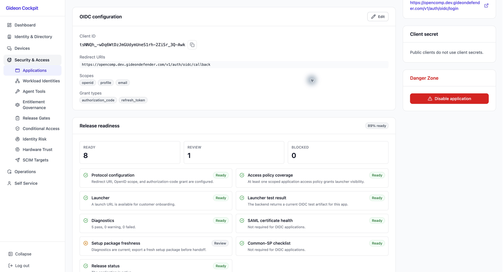

*Review the registered client and its release-readiness checks together.*

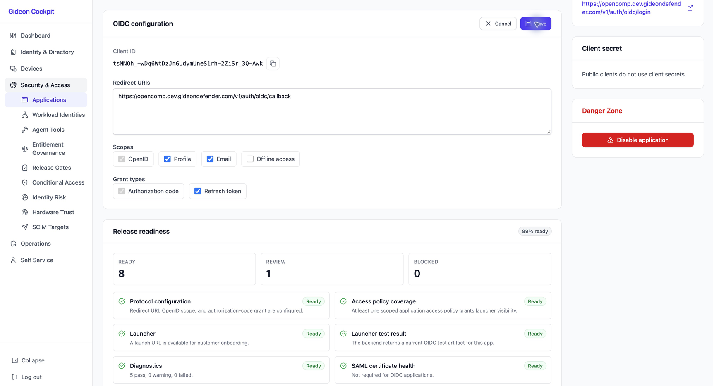

*Use the OIDC editor to update the registration; save only after checking the target environment's values.*

The captured integration registers only `/v1/auth/oidc/callback`. A callback URI belongs in the redirect list; the `/v1/auth/oidc/login` URL belongs in the launcher field.

For the captured **public** client, omit `OIDC_CLIENT_SECRET`. If your deployment deliberately uses a confidential client, its secret must match the registered client and be stored in the server's secret configuration.

### Connect OpenComp to the provider

The **OIDC provider references** card supplies the issuer and discovery endpoints. The captured development values are:

| Reference | Development example |
|---|---|
| Issuer | `https://gideon.dev.gideondefender.com` |
| Discovery document | `https://gideon.dev.gideondefender.com/.well-known/openid-configuration` |
| JWKS URI | `https://gideon.dev.gideondefender.com/.well-known/jwks.json` |
| UserInfo endpoint | `https://gideon.dev.gideondefender.com/v1/oidc/userinfo` |

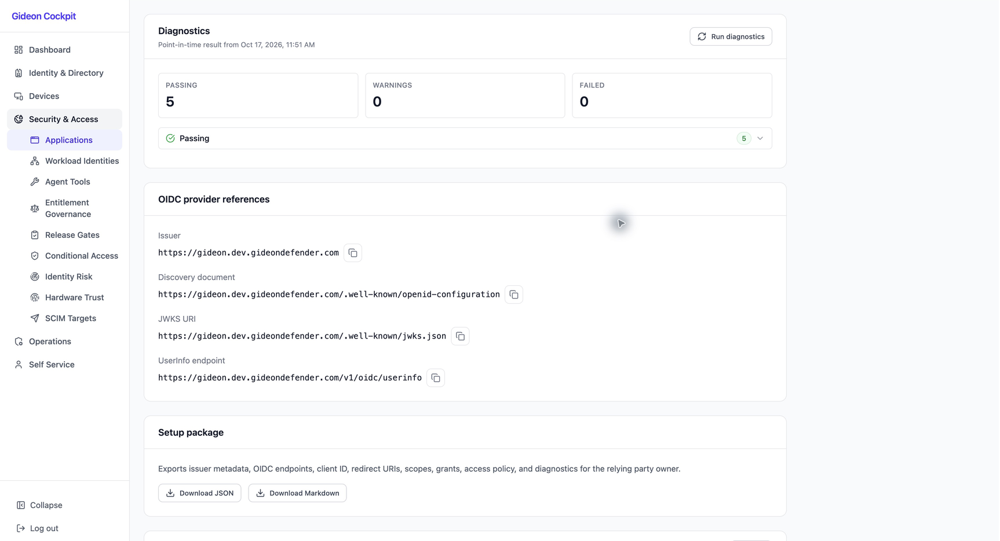

*Copy provider references from the application. Diagnostics describe the configuration at the time shown.*

A deployment administrator can use this browser-login example in the OpenComp API's runtime configuration, replacing the client-ID placeholder:

```dotenv
OIDC_ISSUER_URL="https://gideon.dev.gideondefender.com"
OIDC_CLIENT_ID="<client ID copied from the OpenComp application>"
OIDC_REDIRECT_URI="https://opencomp.dev.gideondefender.com/v1/auth/oidc/callback"
OIDC_SCOPES="openid profile email"
# Public PKCE client: leave OIDC_CLIENT_SECRET unset.
```

Apply these settings to the API through your deployment process. OpenComp's frontend uses the API for authentication. See the [self-hosting environment reference](../../packages/docs/self-hosting/env-reference.mdx) for the remaining deployment settings. Direct API Bearer-token verification has separate issuer and audience settings; do not infer those values from the browser client ID or this example.

### Select who may access the application

Open **Access policy → Edit** and select the intended access scope and permitted users or groups. The captured application permits selected direct users; the crop below excludes their identities.

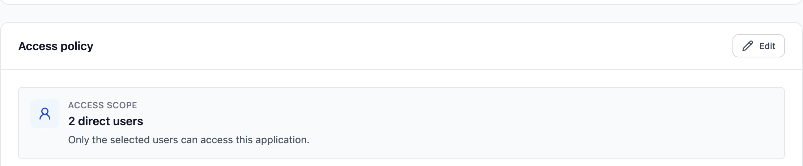

*The access policy controls eligibility to use this Gideon application.*

Application access and OpenComp roles are separate checks. A person who can launch the application still needs an OpenComp role entitlement for the correct organization. Use **Access trace** to investigate a particular user's eligibility when necessary; keep personal directory details out of shared setup material.

### Map groups to OpenComp role entitlements

In **Application entitlements**, use **Edit roles** to review or define the application's roles. Each role has a key, display name, **Entitlement value**, and mapped groups. The captured **OpenComp Admin** role maps **OpenComp Admins** to entitlement value `admin`.

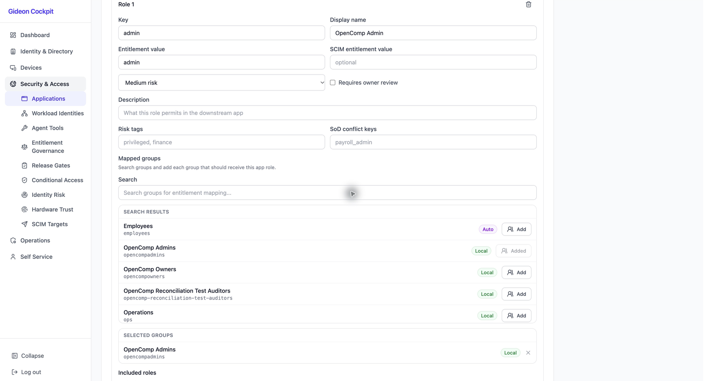

*The entitlement value must match the role name that OpenComp recognizes.*

Use exact, case-sensitive role names. OpenComp recognizes the built-in values `owner`, `admin`, `auditor`, `employee`, and `contractor`, plus custom role names defined in that organization. A friendly display name such as **OpenComp Admin** does not replace the entitlement value `admin`.

| Group mapping example | Entitlement value | Intended access |
|---|---|---|
| OpenComp Admins (captured mapping) | `admin` | Administrative permissions in OpenComp |
| OpenComp Owners (captured mapping) | `owner` | Full organization ownership; restrict this group carefully |
| OpenComp Audit Team (illustrative) | `auditor` | Auditor permissions |
| Portal Employees (illustrative) | `employee` | Employee portal access and applicable compliance obligations |

For a custom role, copy its exact OpenComp role name into **Entitlement value**. The optional **SCIM entitlement value** is a separate field; filling it does not replace the OIDC entitlement. Review **Included roles** as well: assigning a role can also grant included roles and their descendants.

After editing, use **Create draft**, inspect the entitlement preview and effective assignments, and publish the reviewed version. Check required owner reviews and any role-conflict warnings before publishing. Confirm that the intended users actually belong to the mapped groups.

For example, the following fictional verified ID-token claims describe an auditor assignment. These values are illustrative; they are not a token to paste into Gideon:

```json
{
  "sub": "example-subject-001",
  "tid": "org_example",
  "email": "alex@example.com",
  "email_verified": true,
  "entitlements": ["auditor"]
}
```

The real tenant claim must identify the intended OpenComp organization. OpenComp accepts configured tenant-claim names, with defaults including `tid`, `tenant_id`, `organizationId`, and `tenantId`; conflicting tenant values are rejected. The subject identifies the person within that tenant. Matching an email address alone does not authorize access to another organization.

OpenComp evaluates the **verified ID token's** `entitlements` array against that organization's role names. Confirm the claim is present there, even if a UserInfo response also shows it. In deployments enforcing IdP assignments, no matching role produces a `no_role` sign-in error. A deployment still in audit mode records the comparison without applying role changes; the deployment administrator must confirm enforcement covers the organization before treating this as a completed rollout. Background revocation also depends on the entitlement-reconciliation worker being configured and enabled.

### Validate the complete sign-in journey

1. Run **Diagnostics** and review failures or warnings. Review **Release readiness** and refresh the **Setup package** export after configuration changes. Download JSON or Markdown when handing the settings to the deployment administrator; share the export only with its intended administrators.
2. Review **Test connection / Run smoke test**. A passing configuration check does not establish that a particular user's group membership, tenant, and role are correct.
3. With a designated test account, open **Self Service → Apps** and launch **OpenComp**, or use **Continue with Gideon** from OpenComp. Start a fresh sign-in after publishing entitlement changes.
4. Confirm arrival in the intended organization and access appropriate to the assigned role. For example, an auditor should see permitted audit content without administrative mutation controls; an employee should reach the employee portal.
5. With a separate test account outside the permitted scope, confirm the access policy denies access. When validating entitlement removal, have the administrator confirm the reconciliation run and resulting session revocation as well.

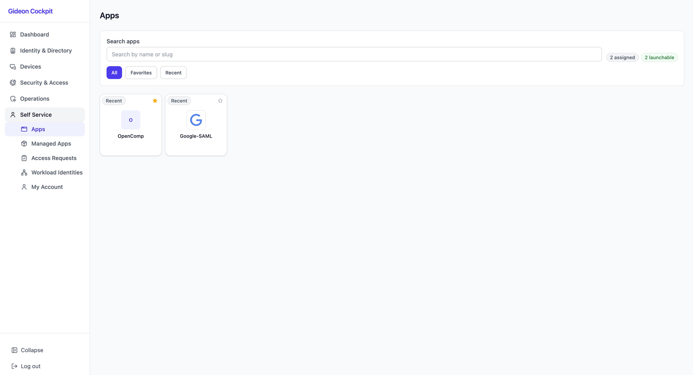

*Self Service → Apps is the user's launch view. Seeing a tile is one check in the complete sign-in journey.*

| Symptom | Check |
|---|---|
| Redirect URI mismatch | Compare `OIDC_REDIRECT_URI` with Gideon's registered URI character for character; check which public hostname routes to the API callback. |
| OpenComp is unavailable in Apps | Check application status, access scope, and the user's access trace in Gideon. |
| App launches but OpenComp reports no role | Check published entitlement values, group membership, the verified ID-token claim, organization mapping, and enforcement scope. |
| A custom role has no effect | Check that its definition exists in the target OpenComp organization and that the entitlement value matches its exact name. |
| Login fails after a client-type change | Check that a public PKCE client has no configured secret, or that the confidential client's server secret matches its registration. |
| User reaches the wrong organization | Check the verified tenant claim and subject linkage with the administrator; editing an organization URL cannot repair identity mapping. |
| Removed access remains active | Check publication and group changes, then the enabled reconciliation worker and its latest successful run. |

## System roles (read-only)

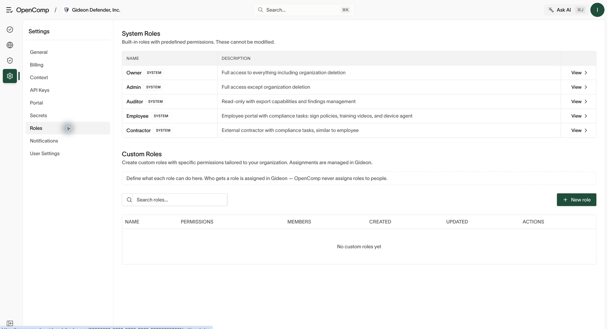

*Settings → Roles separates fixed system roles from custom role definitions.*

Use **View** on a system role to inspect its permissions. The Custom Roles area explains that definitions live here and assignments live in Gideon. An empty Custom Roles table means no custom definitions exist; it does not mean the organization has no members.

Owner / Admin / Auditor / Employee / Contractor are fixed. Open **Settings → Roles → System Roles → View** for a read-only breakdown of exactly what each built-in role can do. Notes:

- The **Auditor** role cannot require employee compliance because it lacks portal access. Create a custom role with the **Employee compliance obligation** enabled when an auditor must also complete training.
- Owners additionally hold every permission implicitly, including `organization:delete`.
- **Findings are auditor-raised**: among built-ins, only the Auditor role holds `finding:create`/`finding:delete`; owners and admins hold `finding:read`/`finding:update` (view and transition status) only.
- **Obligation assignments live in Gideon**; the system-role pages here are reference-only.

## Built-in permission resources

Permissions use `resource:action`. Resources: `organization`, `member`, `invitation`, `team`, `control`, `evidence`, `policy`, `risk`, `vendor`, `task`, `framework`, `audit`, `finding`, `questionnaire`, `integration`, `apiKey`, `trust`, `pentest`, `app`, `training`, `portal`, `secret`, `backgroundCheck`, plus the role-management resource (`ac`). Notable gates: `app:read` enters the main app at all (portal-only roles lack it); `secret:*` is owner/admin only and excludes auditors; `audit` has no `delete` action; `backgroundCheck` is create/read only (no update/delete); `apiKey` is create/read/delete only (no update). Separately, roles carry **obligation** flags (e.g. `compliance: true`) which impose requirements rather than granting powers — see custom roles below.

## Custom roles (CRUD — create, edit, delete)

1. **Create** — Settings → Roles → **New role** (needs `ac:create`). Name the role (starts with a letter; letters/digits/spaces; 2–50 characters), then set:
   - **App Access** toggle (`app` resource) — whether holders can enter the app.
   - **Employee compliance obligation** — a `compliance: true` obligation flag (not a `resource:action` permission) marking the role as compliance-required; togglable only if you yourself can grant portal access, and enabling pulls in the full `portal` permission set.
   - **Permission matrix** — per resource, choose **None / Read / Write** (Read = `:read`; Write = every action the resource supports). Sections: Compliance (all resources) and Security (pentest). A "Select All" exists per section. You can only grant permissions you hold yourself — options you lack are hidden.
2. **Edit** — Settings → Roles → row → View/Edit (needs `ac:update`). If members hold the role, renaming requires type-the-name confirmation; a warning explains that holders lose enforcement until Gideon matches, so prefer creating a new role and migrating assignments. Permission changes apply immediately ("effective on their next request").
3. **Delete** — row overflow (needs `ac:delete`). Blocked while holders exist: remove assignments in Gideon first, then delete; the holders count of zero is your check.

A new custom role alone grants nobody access — assign the role name to people in Gideon (exact, case-sensitive match).

## The auditor rule

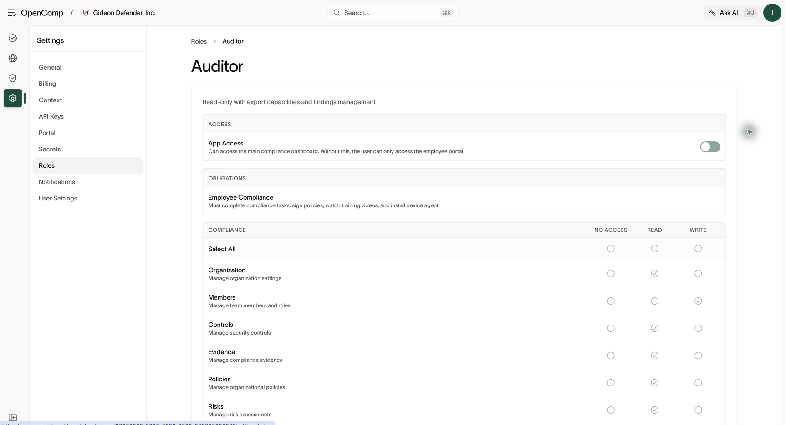

*Auditor role reference: App Access is on and Employee Compliance is off; the controls are disabled.*

The disabled switches and permission matrix are reference values. They are not controls for assigning this role to a person. To give someone the role, change their assignment in Gideon, then verify their access after sign-in.

The **Auditor view** (sidebar item) is visible only to holders of the built-in auditor role or a custom role whose permission set explicitly contains `audit:read`. Owner/admin implicit all-permissions does **not** surface the Auditor view; an owner must be assigned the auditor role (or such a custom role) in Gideon to serve as a preview-auditor. Auditor-only users (auditor is their only role) don't get the **Settings** rail at all, keeping the workspace read-only.

---

# 3. Settings

The Settings sidebar holds: General, Billing, Context, API Keys, Portal, Secrets, Roles, Notifications, Browser connections, and your own User Settings. Billing and Browser connections appear for the relevant products (billing is part of the security product; browser connections with web automations).

## General

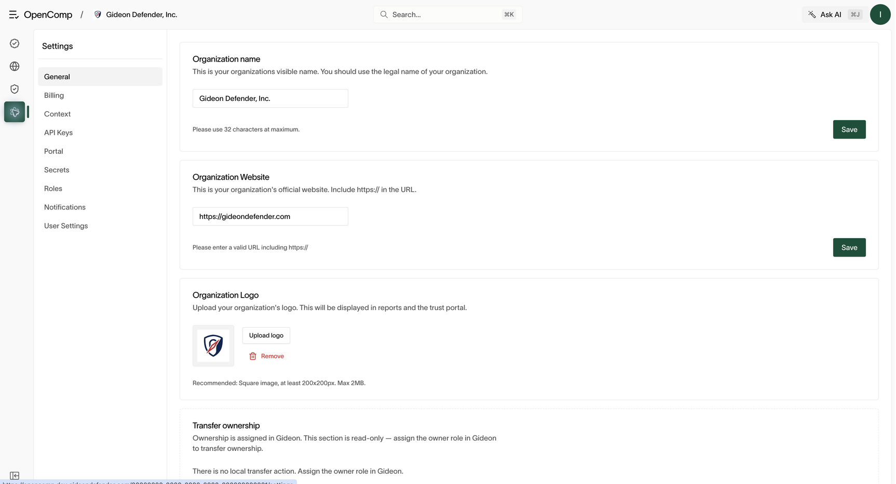

*General settings provide separate Save buttons for organization name and website, followed by logo and ownership guidance.*

Check the organization name in the header before editing. Save the section you changed, then reopen it to confirm the value. The ownership section directs you to Gideon; the organization deletion action below it is a separate, destructive operation.

- **Organization name** (≤32 chars), **website** (must include `https://`), **logo** (image ≤2 MB; square ≥200×200 recommended). Save each section and reopen it to confirm.
- **Transfer ownership** — read-only guidance: ownership is assigned in Gideon; there is no local transfer action (visible to owners with `organization:delete`).
- **Delete organization** (owners with `organization:delete`) — destructive; requires typing the word `delete` to confirm; redirects to the root on success. Cannot be undone.

## Billing

Visible for the security product; mutations need `organization:update`.

- **Add-ons** tab — cards for **Penetration Tests** and **Background Checks** with plan price, included quantity, free-trial badge (14 days when eligible), "X of Y remaining this period", and links into each plan page.
- **Usage** tab — allowance cards (remaining, used, renewal date) and a **Run history** table of every paid run (pentest scan or screening) with billing attribution.
- **Billing Details** tab — payment method ("Billing set up" vs "Payment method needed"; opens the Stripe billing portal or starts a setup session), **business details for invoicing** (company name, billing email, purchase order, address lines, tax ID type+value with cross-field validation), and an **Invoices** table with hosted-URL and PDF download per invoice.
- **Plan pages** (`Settings → Billing → add-ons → product`) — cards per plan tier. CTA logic: current plan (disabled), trial eligible ("Start free trial — add a card now, pay only if you keep it"), switching plans opens a **Confirm plan change** dialog explaining proration (or immediate charge when upgrading within a trial). Subscribe redirects to Stripe and returns on success.

Keep a current payment method: metered features (pentest scans, background checks) require one.

## Context

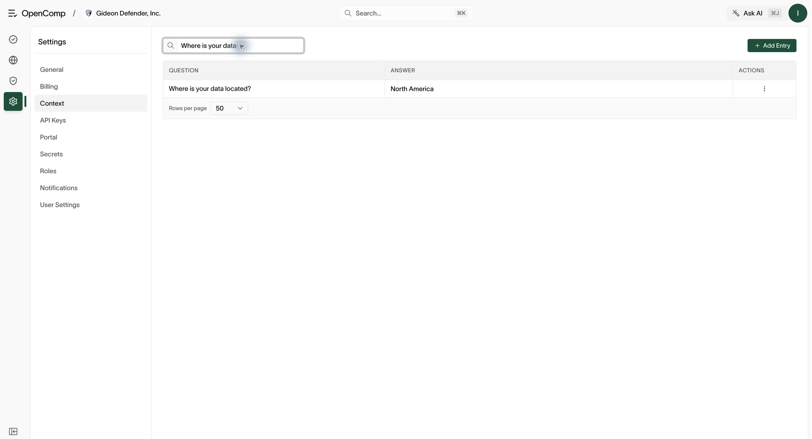

*A Context search narrows the table to one question and its saved answer.*

Use **Search context…** before **Add Entry** to avoid conflicting answers to the same question. Here the search finds the data-location answer. Clear the search to return to the full table. A question with no useful answer needs an update; a matching row alone does not prove the information is current.

Requires `evidence:read` to view; `evidence:create`/`update`/`delete` to manage. This is the authoring surface for **Context Q&A** — factual question→answer records the AI (assistant, questionnaires, ISMS, SoA) draws from.

1. **Add Entry** (top right) — create a question and its answer. Search existing entries first to avoid duplication. Record question and answer; create the entry.
2. **Search and paginate** — server pagination (25/50/100 per page) via URL query params.
3. **Click-to-edit answers** — even outside edit mode, answer cells open an editor on click: plain answers become a textarea; **structured answers are smart**: objects render key/value fields; arrays render repeating items with Add Item / per-item delete ("c-suite"/"executive" questions get name+title fields). Saves via PATCH; failures toast and revert.
4. **Delete** — row overflow → confirm ("cannot be undone").

Update entries when systems, services, or responsibilities change. Never store credentials here.

## API Keys

Requires `apiKey:read` to view; `apiKey:create`/`apiKey:delete` to manage.

- **Add API Key** — name, expiration (never / 30 days / 90 days / 1 year), and scope choice: **Full Access / Read Only / Custom** (Custom = per-resource checkboxes with group counters). Create is blocked without `apiKey:create`, an empty name, or zero scopes.
- The secret value is **shown once** — copy it immediately.
- Scoped keys display an "N scopes" badge with a hover list; legacy unscoped keys are flagged **Full Access (Legacy)** with a recommendation to rotate them.
- **Revoke** from the row overflow (confirm; cannot be undone). Use the list's **Expires** and **Last Used** columns in access reviews.
- Requests authenticate with the `x-api-key` header. See §33.

## Secrets

Requires `secret:read`; `secret:create`/`update`/`delete` to manage (owners/admins; auditors excluded).

- Names must be `UPPER_SNAKE_CASE` (e.g. `GITHUB_TOKEN`); store value, category (API Keys / Database / Authentication / Integration / Other), and description.
- Values stay masked (`••••••••••••`). **Reveal** fetches plaintext on demand, one row at a time, and then shows a click-to-copy chip.
- **Edit** diffs the fields (value optional) and updates only changed ones. **Delete** requires an explicit confirm.
- Never paste secrets into tasks, policies, comments, or chats.

## Portal

Org-level switches (need `organization:update`) that control what employees see in the portal: **Device Agent step**, **Security Training step**, **Whistleblower Report form**, **Access Request form**. Confirm the employee experience after changing these.

## Notifications

Requires `organization:update`. A role × notification-type matrix: Policy Updates, Task Reminders, Task Assignments, Mentions, Weekly Digest, Finding Updates — per built-in and custom role. Save enables only when something changed. Owners/admins can still opt out individually (see §32); all other roles follow matrix settings.

## Browser connections

Requires `integration:read` to view. These are stored vendor logins used by evidence-collection browser automations (see §10).

- **Connect a vendor** (`integration:create`) — sign-in flow with stored credentials; SSO providers use live-browser takeover.
- **Make permanent** — for password logins where 2FA can be automated, store an authenticator **setup key** (enrollment secret — *not* the rotating 6-digit code) in the connection sheet; codes are generated per run. A banner nudges connections whose 2FA status is "no key."
- **Manage** (`integration:update`) per connection: reconnect, rename, change stored username/password, add/replace/turn-off TOTP setup key, view facts (method, connected-as, automation count, status, vault-backed secure storage).
- **Remove** (`integration:delete`) — inline two-step confirm; warns when automations rely on the connection.
- Password connections renew automatically when supported; SSO sessions can require manual reconnect. Renew before expiry or scheduled automations stall.

## User Settings (per person)

Open Settings → User Settings — no route permission needed.

- **Login Email** — read-only, managed in Gideon.
- **Email Notification Preferences** — 7 checkboxes (policy notifications, task reminders, weekly digest, unassigned items, mentions, task assignments, finding notifications). A **Save** and **Enable/Disable all** appear only to admins/owners; for others the role-controlled switches show a lock with "managed by admin" note (§32).
- **AI / MCP organization** — if you belong to more than one organization, choose the one your AI/MCP requests act on. Until you pick one, AI/MCP can't act on your data.

---

# 4. Overview dashboard

Requires `framework:read`. Tabs: **Overview**, **Findings**, **Timeline** (timeline only while its feature flag is enabled for your org).

## Overview tab

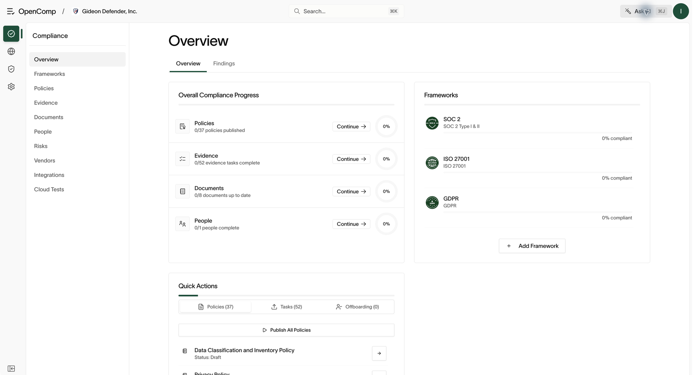

*Overview shows four compliance progress areas, framework progress, and the Quick Actions tabs.*

Start with a **Continue** button beside an incomplete area. In this workspace, policies are still drafts and the four progress areas remain at zero. Use **Quick Actions → Tasks** to open outstanding evidence work. Confirm progress after the underlying policy, task, document, or employee requirement is complete.

- **Compliance card** — overall percentage averaged from four areas: policies published, tasks done, documents completed, people completed. Each below-100% area shows a **Continue** button into the matching page.
- **Frameworks card** — per-framework progress rows; click to open a framework; **Add** (needs `framework:create`) opens the picker of available standards not yet active.
- **Quick Actions** — three tabs:
  - **Policies** — unpublished policies with direct links, plus **Publish all policies** (needs `policy:update`). When publishing would invalidate signed employee acknowledgments, a confirmation dialog appears listing that consequence before you proceed.
  - **Tasks** — incomplete tasks with links.
  - **Offboarding** — members with pending offboarding checklists, including per-member progress; opens the member's Offboarding tab.
- **Nudges** — up to three dismissible prompts: pending offboarding, available framework updates, Trust Portal setup (never nudges when trust state can't be confirmed).

The dashboard includes **Overview** and **Findings** tabs; counts update live. A percentage describes recorded coverage — it is not a certification or an audit opinion.

---

# 5. Findings

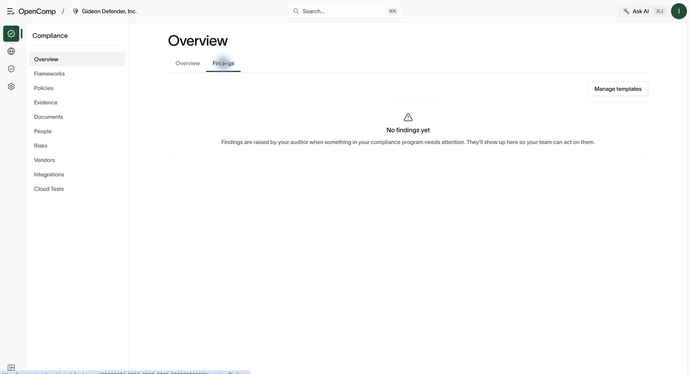

*The Findings tab shows an explicit “No findings yet” state and a Manage templates action.*

This is an empty findings register, not proof that an audit found no issues. In the captured owner/admin session, **Manage templates** is visible but **Add finding** is absent. Use the auditor role or a suitable custom role for the creation flow described below; do not create a task as a substitute for an audit finding.

Reached from the Overview → **Findings** tab (badge shows the open count) or the findings deep link. Findings can attach to a **Task, Policy, Vendor, Risk, Member, Device, document type, or an Area**.

## Create a finding

Needs `finding:create`; the button is hidden without it. Among built-ins only the Auditor role holds `finding:create`/`delete` — owners and admins can view and transition status (`finding:update`) but not create or delete findings.

1. **Add finding** → choose target kind, then pick the entity from the matching list; choose severity (critical/high/medium/low) and the framework (the org's enabled standards; the form auto-corrects wrong default frameworks for non-SOC-2 orgs).
2. Pick a **template** if your organization has finding templates (grouped by category) — selecting one fills the details text.
3. Enter details (required) and save. Submitting without a target is blocked with a toast.

## Work findings

- **Filters** — search text, status (`open → ready_for_review → needs_revision → closed`), severity, framework; sort client-side by last update.
- **Detail** — edit content/severity/status (`finding:update` plus `finding:create` for admin status transitions); `needs_revision` requires a revision note. Status options are filtered to transitions valid for your permissions.
- **Share link** — copy a deep link (`…/overview/findings?open=<id>`); opening it selects the finding and then cleans the URL.
- **Comments** — threaded, per finding; read-only without `finding:update`.
- **Activity** — history of changes, including legacy scope recovery ("originally logged against Directory/Tasks/Devices/Org chart").
- **Delete** (`finding:delete`) — confirm dialog.
- **Templates** (`finding:update`) — manage organization templates alongside the default set.

---

# 6. Compliance timeline

Feature-flagged (`is-timeline-enabled`); the tab is hidden without the flag. Requires `framework:read`.

- Cards per framework cycle: framework name, **Year N** badge, status badge (**Draft** with "awaiting start date" / **Active** / **Paused** (destructive) / **Completed** ✓ with the computed next-cycle date — +6 months for SOC 2 Type 2, otherwise +12 months), and a phase bar with dates.
- There are no mutations here; cards link into the framework. Drafts render dimmed. An organization with no timelines renders nothing.
- Framework detail pages show a matching **Progress** tab with the framework timeline — agreeing with the same flag.

---

# 7. Frameworks

Requires `framework:read`; add/create `framework:create`; edit/sync/delete `framework:update` (delete additionally `framework:delete`).

## Framework list

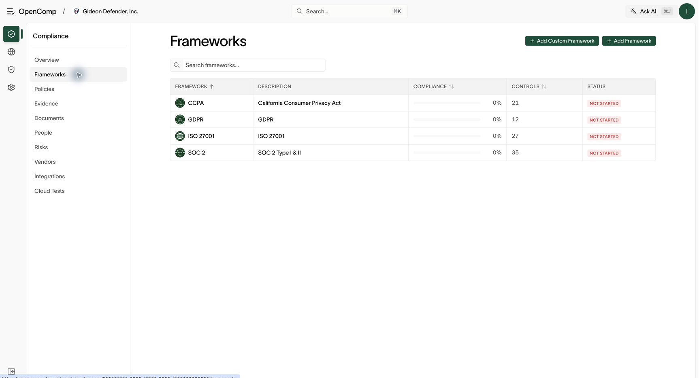

*Frameworks lists the active standards with compliance percentage, control count, and status.*

Use **Search frameworks…** to locate an active standard and open its row. **Add Framework** selects a platform standard; **Add Custom Framework** starts an organization-specific definition. A **Not started** badge and zero percent indicate no recorded completion for that framework.

Searchable table of active frameworks with compliance %, control count, and a status badge (**Compliant** ≥100%, **In progress** >0%, **Not started** at 0%) — sortable by name, compliance, or controls. Supported platform standards include SOC 2, ISO 27001/42001/9001, HIPAA, GDPR, PCI DSS, NEN 7510, CCPA, PIPEDA, NIS 2, DORA, HITRUST; the badge falls back to a letter mark for custom frameworks.

- **Add** — picker of platform standards not already active.
- **Add Custom Framework** — builder sheet for organization-specific frameworks (name/description first; controls/requirements are added in the framework).

## Framework detail

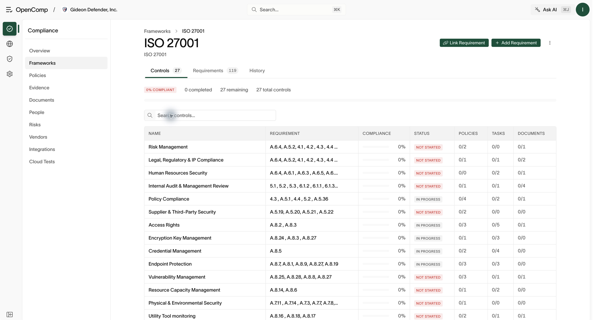

*ISO 27001 opens on Controls, with Requirements and History beside it and a completion summary above the table.*

Check the framework name in the breadcrumb. Compare the **Policies**, **Tasks**, and **Documents** counts to locate missing evidence, then open a control name. This workspace has no Progress tab; the completion summary remains visible above Controls. Use **Requirements** when you need the clause-oriented view.

Tabs: **Progress** (timeline, flag-gated; otherwise a progress bar), **Controls**, **Requirements**, **History**. Use `?tab=` deep links.

- **Controls/Requirements** show grouped views when control families exist, else flat lists, with counts and completion badges.
- **Add Requirement** and **Link Requirement** actions modify the instance (`framework:update`).
- **Edit framework** appears only for organization **custom** frameworks (platform frameworks inherit from the shared template). **Delete framework** is a destructive typed-confirm flow.
- **History** records framework update syncs.

## Version review & apply (framework updates)

When the framework vendor publishes a new version, the detail page shows an **Update available** banner ( vX → vY, release notes, and warnings that an active audit may be affected). **Review update** opens a diff wizard:

1. Stat cards: New / Removed / Modified / Link changes affected.
2. Filter tabs (All / Added / Removed / Modified); scrollable groups show per-item change summaries with badges.
3. **Preserved edits** — your local customizations that won't be overwritten (including local drafts of published policies).
4. **Link changes** — control ↔ requirement/policy/task/document-type link changes.
5. **Apply N changes** (`framework:update`) → confirm → sync; toast "Synced to vX". You can cancel and keep the current version.

## Requirement detail

Breadcrumbs Frameworks → framework → requirement. Header actions: **Link existing control** (pick controls not already mapped) and **Add custom control** (adds a custom control specific to your org's requirement). Body: completion summary with color-coded percent plus the mapped-controls table (per-control: mapped policies/tasks/documents status and %).

Links are made through **link sheets**: need `framework:update`.

## Control detail

Open **Frameworks**, select a framework, and open a control name. Viewing control details requires `control:read`. If the control does not open, ask an administrator to check your permissions.

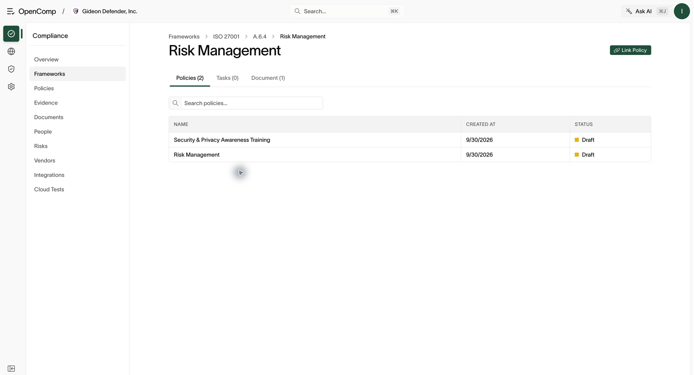

*A mapped control shows its policies and separate Tasks and Document tabs.*

The breadcrumb preserves the framework and requirement context. Switch between **Policies**, **Tasks**, and **Document** to inspect each evidence type. A policy listed as **Draft** is linked but not published. **Link Policy** changes the mapping; opening a listed policy lets you review its content and publication state.

Tabs **Policies / Tasks / Documents** — each with a contextual link sheet: link policies, tasks, or document types to the control; plus a sheet to link the control to additional requirements. The Documents tab notes which document types are marked relevant or not relevant and shows submission counts.

Control links elsewhere in the app can open a cross-framework detail view with **Policies**, **Tasks**, and **Requirements** tabs and a progress summary. The Requirements tab links to the frameworks that use the control. In this view, **Delete** requires `control:delete` and a typed confirmation.

---

# 8. Policies

Requires `policy:read`; create `policy:create`; edit/publish/approve/regenerate `policy:update`; delete/archive `policy:delete`. AI assistant additionally feature-flagged.

## Policy list

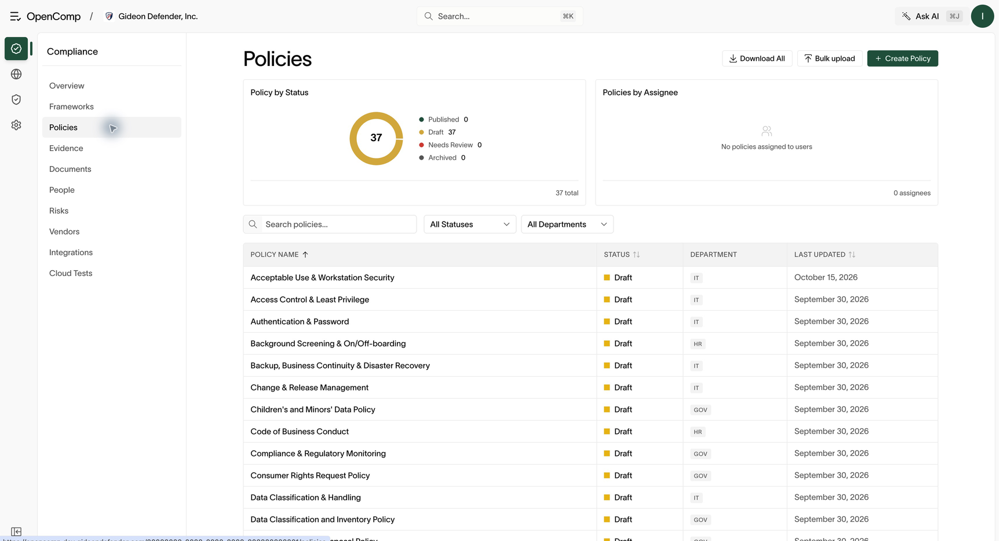

*Policies combines the status chart, assignee summary, filters, and a table of policy records.*

Filter by status or department, or search for the policy title. The captured chart shows 37 drafts and no published policies; the empty assignee summary means no policies have assigned owners. Use these as separate work queues: assign responsibility, review content, then complete the publication workflow.

Charts by status (**Draft**, **Needs Review**, **Published**, **Archived**) plus a filterable table. While the first-run AI generation is tailoring policies, a banner reports progress. Actions:

- **Create policy** — from scratch or a template.
- **Bulk upload** — attach a PDF to an existing policy.
- **Regenerate all policies** — AI-drafts the full set for your frameworks.
- The Overview Quick Actions card offers **Publish all policies** (with acknowledgment-invalidation confirmation; §4).

## Policy detail

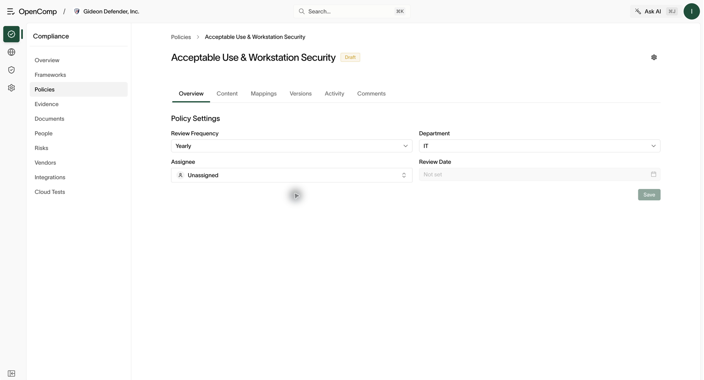

*A policy opens on Overview with Draft status, review frequency, department, assignee, and review date.*

Use **Content** to read the policy rather than inferring readiness from its title. Use **Mappings** to confirm which controls it supports. Changes to the Overview properties use **Save**; that action does not publish the policy. Check the status and Versions separately before expecting employees to sign it.

Tabs: **Overview** (assignee, department, review frequency, review date, approval settings), **Content** (editor view or PDF view; version selector), **Mappings** (add/remove control mappings; see mapped evidence tasks), **Versions**, **Activity**, **Comments** (writes need `policy:update`).

### Lifecycle

```text
draft → submit for approval → (approver approves/rejects) → published → new versions (drafted, approved, published) → archive/delete
```

1. Edit the draft in the rich editor (PDF-format policies open in a PDF viewer).
2. **Submit for approval** — pick an approver (owner/admin members).
3. The assigned approver sees a pending banner with **Approve/Reject** (reject can add a reason comment).
4. **Publish** the version — it counts for coverage and becomes employee-visible (and signable in the portal).
5. **Create New Version** copies the published version (optional changelog) into a draft; the published version stays live while the new one is in flight.
6. **Versions tab** lists current, pending, and historical versions (10 per page) with per-version actions: set active, delete, route to submit-for-approval (`policy:update`; deletes need `policy:delete`).
7. **Archive** or **Delete** from the page header overflow; archived policies can be re-opened.

Practical rules: only published, non-archived policies count for coverage, employee attestation, Knowledge Base, and auditor visibility — **drafts stay hidden from auditors**. Version everything; auditors ask what a policy said at a point in time. Keep mappings current after framework updates.

### AI policy editor

With the AI-assistant flag on, the editor can draft sections, suggest inline edits, and propose changes as reviewable cards you accept or reject. Output quality depends on published policies and Knowledge Base content (§25–26). Review every suggestion — you sign the policy, not the AI.

---

# 9. Evidence and tasks

Requires `evidence:read` or `task:read`. Page labels: the sidebar says **Evidence**; some deployments say **Tasks**.

## Concepts & statuses

- Statuses: `todo → in_progress → in_review → done`, plus `failed` and `not_relevant`.
- Marking a task **Not relevant** requires a **justification** (`task:update` body changes), which renders as a banner on the task page.
- `AutomationStatus`: **Automated** or **Manual**.
- Assignees must hold `app:read`; portal-only employees cannot be assigned — assign their manager or the control owner. The assignee picker is filtered accordingly ("No eligible members" when nobody qualifies).

## Evidence page

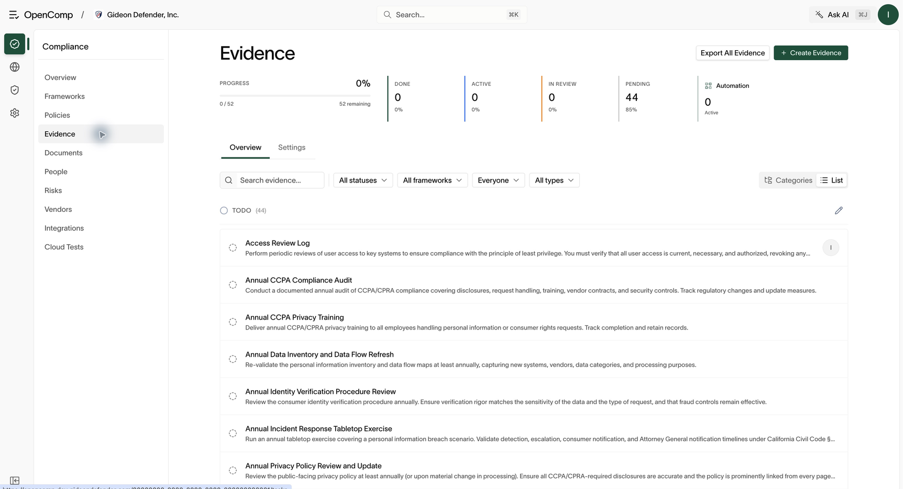

*Evidence shows progress totals, status and framework filters, and Categories/List views.*

Use the filters to narrow work before opening a task. In this capture, 44 items are pending and eight are failed; none are complete. Read a failed task and its evidence before changing status. The Automation count is zero, so the presence of the Evidence page alone does not mean collection runs automatically.

- **Analytics strip** — completion % (done + not_relevant count as handled), tiles for Done / Active / In Review / Pending, and the **Automation Intelligence Hub**: active automations, running-now indicator, success rate, and runs in the last 24 hours.
- **Filters** — status, assignee, framework, automation type (Automated/Manual), free-text search across title+description; the active filter count is displayed. Stale framework filter values auto-reset.
- **Two views** — **Categories** (tasks grouped and recursively drilled by their first mapped control, with per-category stats; the last group is "Uncategorized") and **List** (sections ordered in review → to-do → in progress → done → failed → not relevant). Your view choice is remembered per organization.
- **Bulk actions** — enter selection mode per status section: change status, reassign, or delete as a batch (*status/assignee* need `task:update`; *delete* needs `task:delete`). Bulk status changes respect the evidence-approval workflow and can trigger submit-for-review.
- **Export All Evidence** — for auditor/admin/owner roles; options to include raw JSON; runs as a background job (with a live progress indicator) and downloads `{org}-export.zip`. An export contains confidential material; verify the reporting period and contents before sharing. A successful download proves delivery, not completeness.
- **Org toggle: Evidence approval** — a second settings area on this page turns the approval workflow on or off for the organization.
- **Create Evidence** (`task:create`) — title/description, assignee, control mappings.

## Task detail

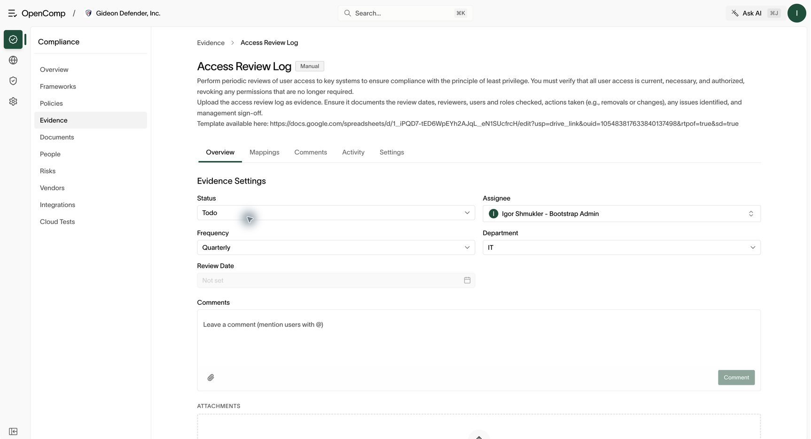

*Access Review Log shows the evidence instructions, task properties, comments, and an attachment area.*

Read the requested proof first. Check the assignee, status, and review frequency in **Evidence Settings**, then add the period-specific file and an explanatory comment. Inspect the attachment after upload and confirm the review/status outcome. A filename or a submitted comment alone is not proof that the requested access review occurred.

Tabs: **Overview**, **Mappings**, **Comments**, **Activity**, and **Settings**. **Automations** appears where automation is available; it is absent from the captured manual task. Supported tabs also accept `?tab=` links:

- **Overview** — click-to-edit title and description (markdown rendering); properties sidebar: status, assignee, approver, frequency (daily/weekly/monthly/quarterly/yearly or none), review date, department, not-relevant state; comments with `@` mentions; attachments.
- **Attachments/evidence** — drag & drop; **100 MB** per file; a security blocklist rejects executable/script extensions (`.exe`, `.bat`, `.js`, `.sh`, `.dll`, …). Pending uploads show spinners; deletion is a confirmed, irreversible action. Comments should describe the period covered, source, reviewer, and exceptions — never passwords or keys.
- **Approvals** (when the org toggle is on) — request approval from any app-access member except yourself (**Submit for review**, `task:update`); the approver gets an orange "Your approval is required" banner with Approve/Reject; admins/owners who are not the approver see **Cancel** in the pending banner. Previous status is remembered.
- **Automations tab** — integration checks (schedule frequency from daily default, editable; see §10), script automations, and browser automations (when web automations are enabled).
- **Mappings tab** (`policy:read`) — which policies reference this task through its controls.
- **Comments/Activity** — full threads and the recorded audit log.
- **Settings tab** — download evidence as ZIP (always available), **Regenerate task** ("Reset to defaults", `task:update`, confirm), **Delete evidence** (`task:delete`).

---

# 10. Task automations

Attach scheduled evidence collection to a task. Three kinds: **integration checks**, **script automations**, and **browser automations**.

## Integration checks

Evidence tasks backed by connected integrations run on a schedule (default **daily**, editable per task). Each run records a status and evaluation result. A failed run needs attention like any overdue task: open it, read the evaluation, fix the gap or configuration — re-running without fixing changes nothing.

## Automation overview (per automation)

Breadcrumb Evidence → task → automation. Click-to-edit name/description; **Edit Script** opens the AI builder. Tabs:

- **History** — runs grouped by date with statuses (`pending → running → completed / failed / cancelled`; an evaluation **Fail** also styles the row), **evaluation badges Pass/Fail**, version badges (`vN` or draft), trigger source (manual/scheduled/API), time ago, and expandable detail: **Evaluation reason**, **Logs**, **Output** (copyable), error box. Beyond three date groups, older runs collapse behind "Show all N runs".
- **Versions** — every published version with changelog and **Test** (▶) to run it immediately (optimistic pending entry appears in history).
- **Activity** — audit log filtered to this automation.
- **Settings** — enable/disable switch, schedule picker, **Delete** with confirm.

## Script/AI automation builder

- Gates: available where the enterprise feature is configured (an internal license secret); the page otherwise shows a lock screen pointing to sales.
- Two tabs: **Chat** and **Workflow** visualizer. The chat can store scripts to S3, **prompt you for a secret or information when needed**, and search/crawl the web (search + website extraction tools). The workflow editor shows the visual pipeline; **Publish** creates a new version (the draft stays editable; changelog required) and auto-runs the published version.

## Browser automations (web-automations feature)

When an API can't provide the proof, schedule **live sign-ins to vendor consoles** and capture screenshot evidence:

1. On the task's browser-evidence section (or Settings → Browser connections) connect the vendor login — stored-password or SSO takeover flow (§3 Browser connections).
2. Describe capture precisely, e.g. "Open organization security settings and capture whether MFA is required for all members." Add a **pass/fail criterion** if you want evaluation; without one the screenshot is reviewed manually.
3. **Test** the automation and watch the live browser; take over when a prompt needs a human (TOTP can be automated with a setup key).
4. Inspect the screenshot: correct organization? correct setting? timestamp? Does it actually support the criterion?
5. Save and review the frequency; run on demand when fresh proof is needed.

| Symptom | Next step |
|---|---|
| Sign-in fails | Check the connection, account status, vendor login changes; reconnect. |
| Human prompt appears | Take over in the live browser, finish the step. |
| Wrong page captured | Make instructions more specific; test again. |
| Evidence is stale | Check frequency/latest run; renew the connection (SSO often needs it). |
| Evaluation fails | Verify the actual vendor setting; fix control or criterion. |

Fast automated runs don't mean the control passed — review evaluation and evidence together.

---

# 11. Documents and evidence forms

Requires `evidence:read`. The Documents hub has tabs **ISO 27001 (ISMS)** (when active; §12), **Overview** (Company forms), and **Settings**.

## Company forms

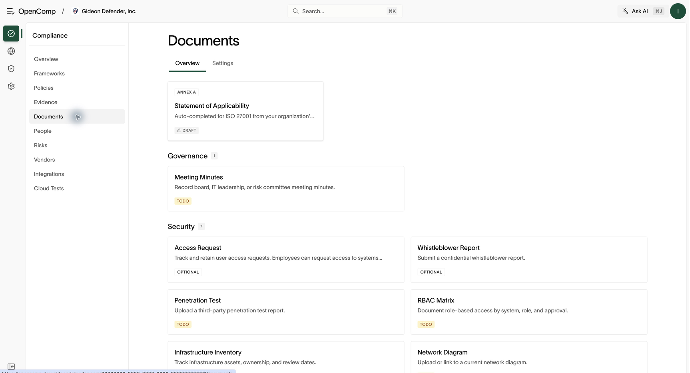

*Documents → Overview groups company forms and links to the Statement of Applicability.*

Choose the form that matches the record you need to retain. **Todo** marks outstanding required documentation; **Optional** is a different state. Open a card to inspect submissions and their dates. The Annex A card opens the SoA directly; it is not the same as an ISMS foundational document.

Card grid grouped by **Governance / Security / People**. Each card shows: required-field count, status badge (**Todo / Complete / Optional / Not relevant**), and a red **"N Issues"** count of open findings against that form.

| Form type | Notes |
|---|---|
| Meeting Minutes — with Board / IT Leadership / Risk Committee subtypes | umbrella card; status "Todo" only when all three subtypes are stale |
| Access Request | portal-accessible; has approve/reject review |
| Whistleblower Report | portal-accessible; date auto-set to now |
| Penetration Test | requires a PDF report upload (for third-party pentests) |
| RBAC Matrix | matrix fields with optional spreadsheet upload |
| Infrastructure Inventory | matrix fields |
| Network Diagram | link or upload |
| IR Tabletop Exercise | wizard with AI analysis |
| Employee Performance Evaluation | — |
| New Account Types Submission | optional, NIST-specific; reached from a control's Documents tab |

**Staleness rule:** a form is "Todo" when never submitted or last submitted **more than 6 months ago**. Keeping them current is part of continuous readiness.

## Record a submission

1. Open a form card → **New Submission** opens the step wizard:
   - Step 1 — compacts fields (submission date defaults today; text/date/select).
   - Step 2 — long-form textareas (placeholders are templates — a warning says reference-only; customize), file uploads (≤100 MB), and **matrix fields** (rows with add/remove; every required cell of every row must be filled, or a companion file substitutes).
   - Step 3 (Review) — full read-back of every field including matrices, plus **AI analysis** for Meeting Minutes and Tabletop Exercise: per-requirement ✓/✗ checks (e.g., board meetings need Risk Management, Cybersecurity, Business Continuity, Fraud topics; tabletop needs scenario, attendee coverage, notes, after-action findings, owners). **Failing analysis disables Submit**, with an explicit "Submit anyway" escape. AI failure never blocks submission.
2. **Upload Evidence** (header) — fast path: file → submission in one step (meeting subtypes via dropdown).
3. Verify the new entry appears; reopen it to check dates/owners/attachments.

## Submission detail & review

- Read-back of all values; textareas render as formatted markdown; files are direct download links; matrices render as tables.
- **Access Request workflow** — submissions arrive `pending`; a reviewer with `evidence:update` (server-enforced for owner/admin/auditor) sees **Approve / Reject** with a required reason for rejection. Reviewed rows show **Reviewed By** and reason. Submitting an access request emails active owners/admins (except the submitter).
- **Delete** is restricted to owners/admins via the row overflow, behind a confirm.
- **Export CSV** per form type (`evidence:read`), including all three meeting subtypes.

## Document settings

The Settings tab lists every non-hidden form with a **"Not relevant"** switch (`evidence:update`). Marking not-relevant: removes it from completion calculations, marks linked framework requirements not relevant, and warns you to still "brief" auditors about it. Toggling back applies immediately.

---

# 12. ISO 27001 ISMS

Available when the ISO 27001 framework is active **and** the ISMS feature flag is on; the ISMS layout redirects elsewhere otherwise. The captured workspace has ISO 27001 active but no ISMS tab in Documents. The Documents and SoA screenshots therefore do not demonstrate ISMS setup, generation, or approval.

## Overview

Stat row: **Documents** (12), **Approved**, **Outstanding**, **Needs review** (drift), **Metrics overdue**. The **Foundational Documents** grid shows each document with clause chip, title, and status. **Run setup wizard** (`evidence:update`).

## The ISMS wizard

Estimates 10–15 minutes; six steps, all pre-filled from your data:

1. **Leadership & accountability** — deputy security/privacy owner; internal-audit approach.
2. **External commitments** — certification body; cyber insurance and insurer; sector regulators.
3. **Workforce & scope** — contractors; production capabilities (pre-filled from Context); cloud hosting split (customer-managed vs provider-managed layers).
4. **Privacy & data** — EU representative (GDPR Art. 27) status.
5. **Certificate scope** — the sentence that will appear on your certificate, editable.
6. **Targets & outcomes** — objectives/targets and intended outcomes.

Save progress per step; Finish validates everything, jumps to the first invalid step, then generates all 12 documents in dependency order with a progress screen.

## The 12 foundational documents

```text
4.1 Context of the organization   6.1.2 Risk assessment methodology
4.2 Interested parties (+reg.)    6.1.3 Risk treatment plan (live)
4.3 ISMS scope                    6.2  Objectives plan
5.1  Leadership commitment        9.1  Monitoring
5.3  Roles & responsibilities     9.2  Internal audit
                                   9.3  Management review
```

Each document page:

- **Generate** — re-derives content from your data (`evidence:update`). Regenerating an approved doc reverts it to draft.
- **Status flow** — `draft` → `in_progress` (generation) → `needs_review` (submitted for approval) → `approved` freezes an immutable published version (`vN`) → `declined` (back to work). Editing an approved doc sets it to draft **while the published version stays live and exportable**.
- **Approval** — pick the approver (from members with `evidence:update`), Submit for approval; the assigned approver Approves/Declines.
- **Drift detection** — after data changes, the doc shows a **Needs review / drift** banner comparing current platform facts to what was approved; regenerate to catch up.
- **Exports** — PDF and DOCX for the current draft and for **any historical version**.
- **Control mappings** — clause ↔ control links editable on the page.

Special behaviors:

- **Interested parties/requirements** must be generated in order (parties first); requirements derive from them.
- **Risk treatment plan (6.1.3)** renders **live** from the Risk Register and Vendors — nothing is stored; submit requires ownership + acceptance (per risk).
- **Monitoring (9.1)** holds append-only measurement history with due dates, overdue flags, and backfill of past periods; submission requires ≥1 active metric with cadence.
- **Internal audit (9.2)** requires ≥1 audit with conclusions; auditor options come from internal-auditor role holders.
- **Management review (9.3)** requires procedure/date/chair (top-management role holders)/attendees/inputs/sign-off.
- **Roles (5.3)** are seeded (governance roles incl. Internal Auditor) and must be made complete.
- Submit-readiness rules are enforced client- and server-side.

---

# 13. Statement of Applicability

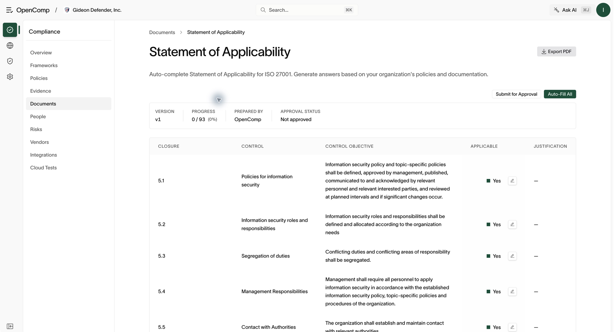

*The SoA displays version, answered progress, prepared-by, approval status, and control-by-control applicability.*

This capture has **Yes** applicability values but **0/93** progress and blank justifications. A default Yes is not a completed answer. Review each control using **Edit answer**, provide a supported justification, and check progress before **Submit for Approval**. Use **Show All** to inspect controls beyond the initial five rows.

Reached from Documents (ISO 27001 orgs). Gates: `audit:*` (create ensures setup; read to view; update to edit/approve). The SoA covers the ISO 27001 Annex A controls; each control shows:

- **Applicable yes/no** (editable swatch + dialog with justification textarea).
- **Justification** — required for every control (ISO expects justification for both applicable and non-applicable choices).
- Auto-rule: a **fully remote** company (detected from Context) is suggested **No** for the physical/environmental (Section 7) controls, with a matching default justification — still editable.
- **Auto-Fill All** — streams an AI completion over your organization's knowledge (policies, context, documents, submissions); uncertain rows render **Insufficient data** rather than guesses. Per row "Processing…" shows progress.
- **Approval** — owners/admins **Submit for Approval** choosing an approver; while pending, editing is locked; the assigned approver **Approves/Declines** from the ALS banner. Version, progress (answered/total), prepared-by, approval dates and names, are shown in the info card.
- **Export PDF** — `statement-of-applicability-<framework>-vN.pdf` with metadata and every answer.
- **First-class audit artifact**: review before every audit, not when the auditor asks.

---

# 14. Risk register

Requires `risk:read`; edits `risk:update`. Assignees must not be portal-only (auditor/employee/contractor excluded from ownership).

## Register

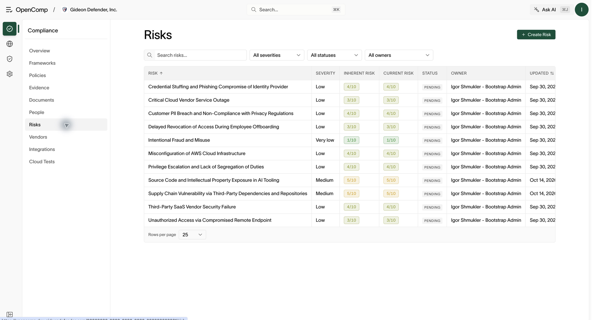

*The risk register separates inherent risk, current risk, severity, status, and owner.*

Search for a risk and open its row to review the underlying assessment. A **Pending** record still needs review even when its displayed severity is low. Compare the inherent and current scores, then inspect the treatment plan and linked work rather than treating a lower number as proof that controls are effective.

- Table with severity scoring badges (likelihood × impact) and current interpolated severity from linked task completion; residual risk per treatment strategy is suggested. The delete actions need `risk:delete`.
- On first use, the onboarding flow offers to draft your risk inventory; onboarding shows a live "Assessing…" state while the AI generates risks, and rows appear as they land.

## Risk detail

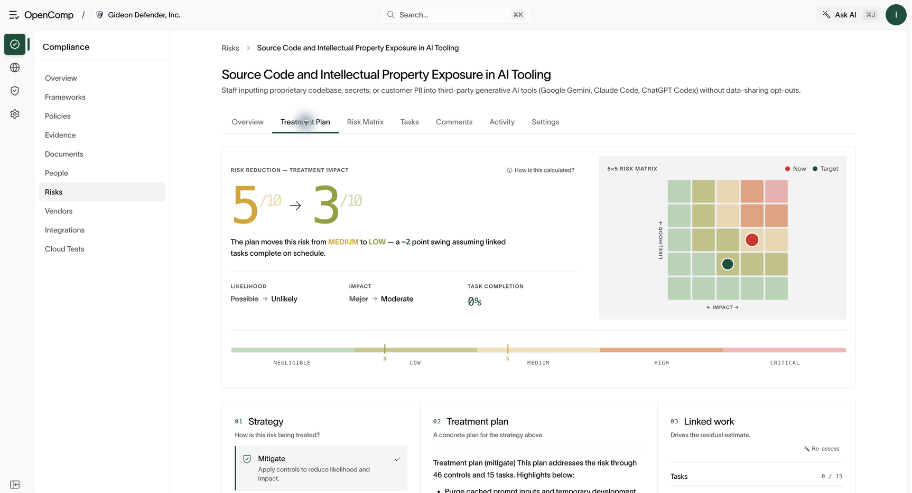

*Treatment Plan shows a projected score change, a risk matrix, task completion, strategy, plan text, and linked work.*

The example projects **5/10 → 3/10** while **Task completion** is **0%**. Read this as the plan’s expected effect, not achieved reduction. Follow linked tasks to inspect evidence. Keep the selected strategy, saved residual assessment, and formal risk-owner acceptance distinct; viewing the forecast records no acceptance.

Tabs: **Overview** (title/description inline-edit; assignee; status; category; department — Save after changes), **Treatment Plan**, **Risk Matrix**, **Tasks**, **Comments**, **Activity**, **Settings** (placeholder).

- **Treatment plan** — strategy **Mitigate / Accept / Transfer** (Accept assumes no reduction; Transfer shifts impact via e.g. insurance). Selecting saves immediately, so change when agreed. Linked Work lists the compliance tasks and their controls; each carries its own evidence workflow.
- **AI assistance** — **Draft plan & suggest links** for new plans; **Suggest tasks & controls** when a plan exists; **Re-assess** reviews the current link set (deselecting an existing task removes that link); **Regenerate with AI** refines the plan and its wording. Use **Edit** for direct changes to the plan text. AI never completes tasks or validates control effectiveness.
- **Forecast vs saved** — treatment shows a projected residual (e.g., 5/10 → 3/10 "at full execution"); with 0% linked tasks complete, it's an outlook, not an assessment. **Risk Matrix** tab shows raw 5 × 5 inherent and residual charts; the residual cell that is dashed is a completion-based suggestion — **Accept suggested residual** or set cells manually (justify from evidence). Look beneath "How is this calculated?" for the math.
- **Formal risk acceptance** — from Treatment Plan, **Record risk-owner acceptance**: choose the accepting member, optional review notes, record. The record captures member/date/rating, is **immutable**, and becomes **stale** when residual likelihood/impact changes (fresh review + acceptance required). Using the Accept treatment strategy doesn't create this record.
- **Tasks/Comments/Activity** — per-entity partnership. Comments never change scores; use the acceptance record for formal sign-off.

---

# 15. Vendor register

Requires `vendor:read`; create `vendor:create`; edit/delete `vendor:update`/`vendor:delete`.

## Register and onboarding

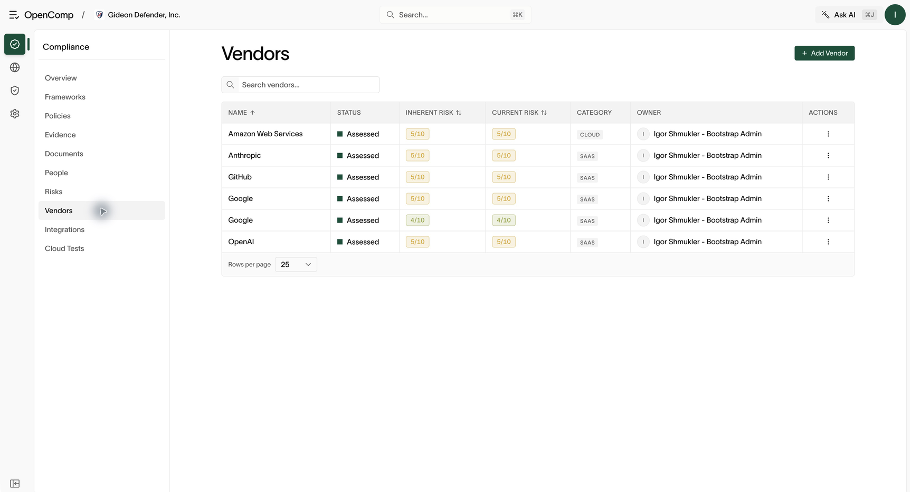

*Vendors displays assessment status, inherent and current risk, category, and owner.*

Open the intended vendor row and verify its website and assessment scope before using its result. Similar names can represent different records, as the two Google rows illustrate. **Assessed** identifies the assessment state; it does not mean low risk or completed treatment. Review the supporting assessment and follow-up tasks.

`Add Vendor` captures name, website, description, category, assessment status, and assignee; keep "Not assessed" until your actual review concludes. On first use the onboarding flow can build the vendor list.

## Vendor detail

Tabs: **Overview** (assignee, website, category…), **Treatment Plan**, **Risk Matrix**, **Risk Assessment**, **Tasks**, **Comments**, **Activity**, **Settings**.

- **AI risk assessment** — a live research feed while the assessment runs (news and docs about the vendor); saved results render as a risk view. **Regenerate assessment** lives in the Settings tab (`vendor:update`).
- **Treatment plan & residual acceptance** behave like the risk record; the acceptance card is vendor-kind.
- **AI plan/link suggestions** mirror the risk module (Regenerate plan, Suggest links/apply).
- **Vendor tasks** — per-vendor follow-ups with owners and dates; task-level links appear as well. Comments/Activity are audit-logged.
- Vendors marked **sub-processors** and their assessment outcomes feed the **Trust Center vendor list** (§29) — keep both current.

---

# 16. People directory

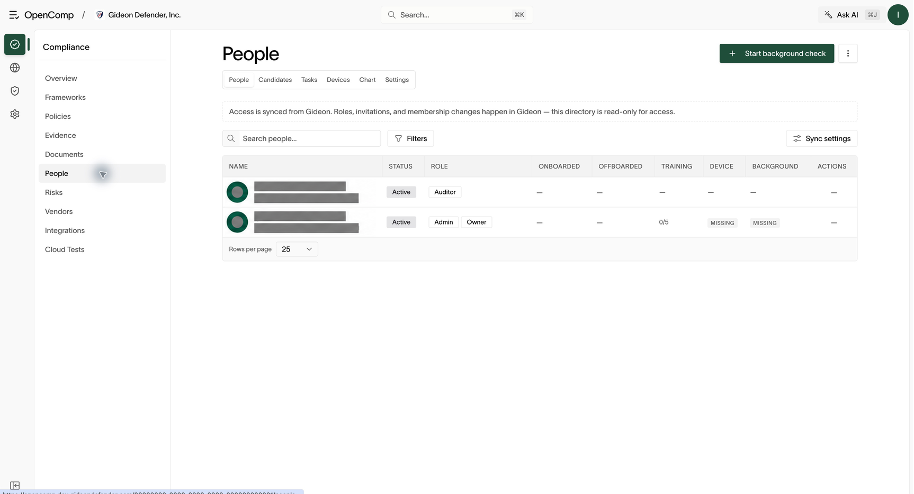

*People shows the Gideon-managed-access banner and employee compliance columns. Names, email addresses, and avatar initials are redacted.*

Use **Search people…** and **Filters** to locate the right person. Roles are displayed for reference; the banner explains where access changes belong. **Missing** device or background evidence is a compliance gap, not the person’s account status. Open the person’s name to inspect their record before deciding what evidence is missing.

Requires `member:read`. Tabs: **People**, **Candidates** (`backgroundCheck:read`), **Tasks**, **Devices**, **Chart**, **Settings** (`organization:update`). Header actions: **Start background check** (`backgroundCheck:create`), and the overflow's **Export offboarding** (org-wide export).

People tab:

- Search; **filters with chips** — Status (active/pending/deactivated), Role, onboarded and offboarded date ranges. Columns: name (with background-clear tick), status, roles (read-only), onboarded, offboarded, and **requirement columns** that render only when org-level tracking is on: policies, training, HIPAA, device, background check, 2FA.
- **Sync settings** popover — pick the **People-sync source** (e.g., Google Workspace or Rippling; auto-syncs daily with last/next times) and the **2FA status source** (`integration:update`). 2FA columns fill from the chosen integration.
- Banner persists: access is synced from Gideon; this directory is read-only for access.
- Row actions: only **Remove Device** (owner; Fleet + agent records via unlink) — everything else happens in Gideon or the employee record.
- Legacy pending invitations are read-only and cannot grant access. Manage assignments in Gideon.

---

# 17. Employee records

Open a person (`member:read`); note tabs conditioned on org flags and roles: Details, Policies, Training Videos, HIPAA Training (HIPAA orgs), Device, Access, Background Check (unless auditor-only), Offboarding (once dated).

- **Details** — read-only grid (name, email, title, department, status, onboard/offboard dates).
- **Policies** — published, required-to-sign policies with signed/not state per person.
- **Training videos** — if the training step is disabled, a notice says training is managed elsewhere (evidence via the Security Awareness Training task). Otherwise a completion banner with **Certificate download** (PDF) and the per-video list.
- **HIPAA training** — same pattern with its own certificate.
- **Device** — agent device card (platform/OS/model, last check-in, and four checks: **Disk encryption, Antivirus, Password policy, Screen lock** with Pass/Fail/N/A rows, detail message and exceptions), compliance badge (Compliant / Non-compliant / **Stale** (no check-in ≥7 days) / Not tracked), or a Fleet policy fallback.
- **Access** — per-integration access rows from integration check results: **Access found / No match / No per-person data / Check not run yet**; expandable field lists power offboarding revocations.

All profile edits stay in Gideon; a profile date alone is not proof accounts were disabled.

---

# 18. Offboarding

Set the member's **offboard date** in Gideon/HR — the Offboarding tab opens.

- **Checklist** — items default to: revoke system access (evidence-required; per-vendor confirmations), remove from identity provider (evidence), retrieve devices (evidence), deactivate email/accounts (evidence), revoke privileged access (evidence), notify teams, exit interview, update org chart/docs. Owners can customize the template (add/remove items, toggle evidence-required on each).
- Work items: check off as done; upload evidence (with download) per item; "show only remaining" until complete.
- **Access revocations** — tied to per-integration access checks; confirm each revocation or confirm-all; deletable.
- **Export** — the summary card exports the offboarding record (once evidence exists); the People header exports all offboardings at once.
- Removing a device session does not disable the person's identity or every third-party access — confirm those separately. Auditors sample access-removal evidence, device return, timestamps.

---

# 19. Background checks

Gates: `backgroundCheck:create` to screen, `backgroundCheck:read` to view.

## Setup

Enable the step in **People → Settings → "Require background checks"** (`organization:update` — note the Portal settings page has no background-check switch); ensure the org has a payment method; configure **Checkr** under Integrations → Checkr (account ID, environment, package, API key — stored encrypted, never shown again). A monthly plan (see §3 Billing) provides included screenings.

## Employees

From the record's Background Check tab: **Order** (Checkr) or **Attach outside report** (PDF: Checkr/Sterling/other); the contact email is used for consent, notes stay internal. Existing checks show a status strip (invited → in progress → in review → completed / completed-with-flags / failed / cancelled / exempt), an admin actions row (**Retry / Cancel / Delete** per member permissions), the report snapshot (shareable summary + copyable), attachments, and an **audit timeline**. Exempt members skip the step; exemptions are **read-only here** (managed elsewhere) and should be rare, named, and time-boxed.

> Screening is a hiring control, not access provisioning — keep the two decisions and approvers separate.

---

# 20. Devices and the device agent

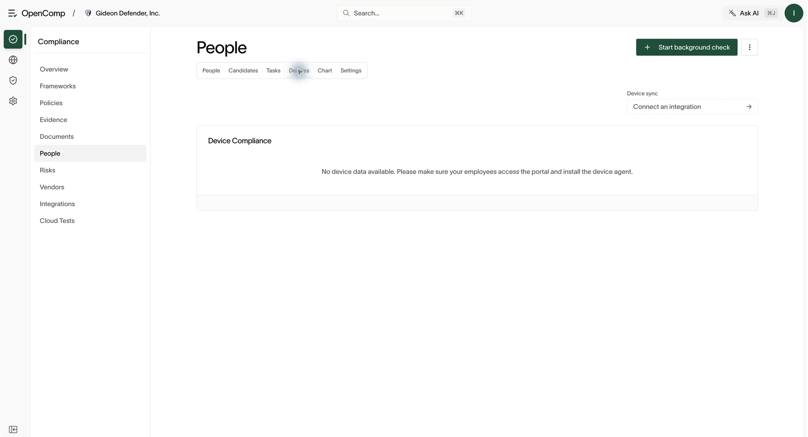

*People → Devices shows Device sync and an explicit message when no device data is available.*

Follow the employee portal installation flow for agent-based collection, or use **Connect an integration** for an inventory source. Return here after a successful check-in or sync. An empty page provides no evidence that devices pass encryption, antivirus, password, or screen-lock requirements.

Devices tab (`member:read`):

- **Sources** — device agent (`Compliance`), Fleet hosts (policy results incl. MDM), and integration-imported inventories. Agent devices take priority over Fleet for the same member; imports never suppress Fleet.
- **Compliance donut** — Compliant / Non-compliant / **Unverified** (imported devices judged against the four canonical checks; agent devices stale >7 days count non-compliant), with total count center. Empty chart: "install the device agent via the portal."
- **Agent Devices list** — searchable (device/user/email/platform), source filter, **Export CSV**, pagination; columns device, user, platform, source, last seen (online indicator <2h), checks, compliance; row actions open detail (four canonical checks + extras, per-detail messages/exceptions, **Revoke agent access**) or **Remove device** (`member:delete`).
- Integration devices list offers the **device sync selector** (`integration:update`): pick which integration provides device inventory, sync-now button; don't auto-sync option; "Needs reconnection" for errored connections; a dashed slot to connect one.

**Device agent** — an auto-updating desktop app (macOS/Windows) your employees install from the portal:

- Collects device identity (name, hostname, platform, OS build, serial, model).
- Hourly, runs four checks — **disk encryption** (FileVault / BitLocker / LUKS), **antivirus** (XProtect / Defender / ClamAV), **password policy** (min-8 requirement at OS level), **screen lock** (auto-lock ≤15 min) — and posts raw evidence (command output) on every check-in.
- Suggests remediations for failed checks (some auto-fixable, some admin-only, some guidance).
- Onboarding: the user signs in through the configured organization login flow, device upserts per organization by serial; the tray reports to **all** orgs the person belongs to; session can be cut from Devices → **Revoke agent access (member:update)**.
- Every laptop should appear exactly once from exactly one source; reconcile duplicates rather than ignoring them; review unlinked devices weekly.

---

# 21. Org chart

People → Chart (`organization:read` to view).

- **Two modes** — interactive chart (React Flow editor: pick people from the directory, connect reporting lines, save with `organization:update`) or an **uploaded org-chart image** (S3 upload ≤100 MB; images + PDF whitelist; view mode renders it).
- Upload/save actions are replaced by a Create or Upload state initially. It is an audit-evidence artifact — keep it consistent with roles and offboarding edits.

---

# 22. Penetration tests

Rail: **Security** → sidebar "Penetration Tests" (`pentest:read` required to reach the rail at all).

## List & posture

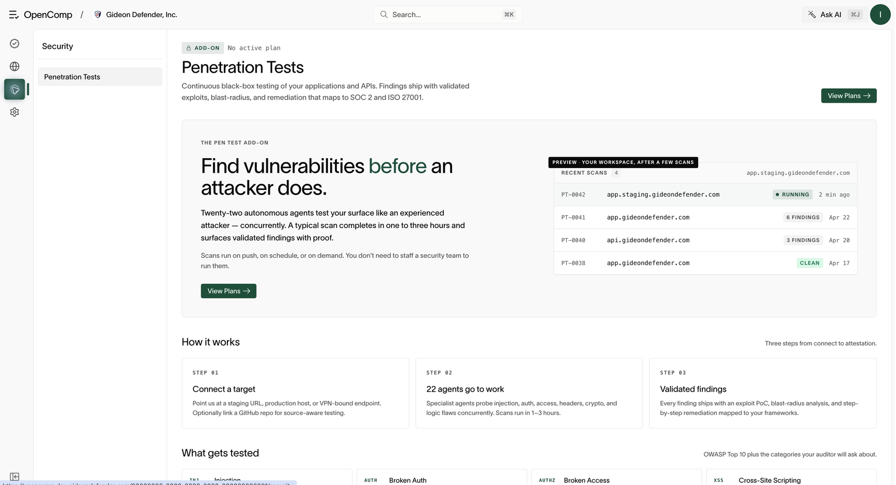

*The Security page shows the View Plans entry point when the workspace has no active penetration-test plan.*

This is a plan-selection screen, not a completed assessment or a clean report. If your page looks like this, ask the billing owner to review the required plan. Where scans are available, select an existing run and verify its target, completion state, date, and report before relying on its findings.

- Left: run list (ID `PT-####`, target, status, progress bars while running, failure reason in red) with a quota footer.
- Right: empty onboarding ("Pick your most exposed target… agents run ~1–3h… signed report"), in-progress summary, or a **posture overview** for completed scans (scans/targets/last sweep, latest assessment with immediate Markdown/PDF download, cadence stats, **stale coverage** list per target).
- Billing math: subscription remainder + available wallet credits; without any, create is disabled and a marketing panel offers **View plans** into billing.

## Start a scan

1. **New Scan** (`pentest:create`; viewing the page needs `pentest:read`; runs consume plan allowance). Choose a profile:
   **Quick** (discovery/exposure, report-only, ~5–15 min) · **Standard** (default; safe proof, ~30–90 min) · **Deep** (impact proof, all 12 checks, ~2–8 h) · **Custom** (picking checks/evidence differs from a preset).
2. Target URL (https enforced; a repository URL can be added) and optional context for the agent (≤4000 chars; your per-finding context notes for the target auto-attach).
3. Advanced options: **Evidence level** — `report_only`, **safe_proof (recommended)**, `impact_proof` (confirm dialog; may trip WAF/rate limits — staging or approval required) — and the **12 checks**: discovery, secrets & info disclosure, technology config, XSS, injection, authentication, authorization, IDOR/BOLA, SSRF/XXE, CSRF, race conditions, business logic. Discovery is always enforced.
4. **Authorization consent** — attestation that you own or are authorized to test the target (hard-required).
5. Submit → run detail. Statuses: provisioning → cloning → running → completed | failed | cancelled (live, ~4 s refresh). Show: per-agent progress grid (default 22 agents), severity tally, streaming findings (new rows flash), and the agent activity log.

## Read results

- Findings table by severity; each finding: summary, endpoint/status/CVSS/CWE strip, PoC (copyable), impact, remediation, attack path/evidence tabs.
- **Per-finding context notes** (`pentest:update`) — how the team treats a finding (accepted-by-design / fixed etc.) — and are fed back to the agents next time this target is scanned.
- A clean run renders an audit-grade **attestation** page; downloads are what ship — **Markdown** and **PDF** (also one click from the posture card). There is no in-app public share link; run pages are deep-linkable.
- Nothing running equates to secure: a failed run is not a clean scan; read failure reasons, fix target/config, re-run.

---

# 23. Cloud security tests

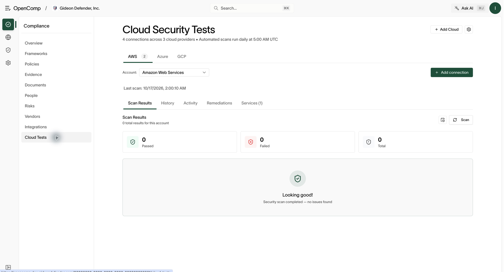

*Cloud Security Tests shows provider and account selection, last-scan time, result counts, and service coverage.*

The captured account displays **0 total results** despite a “Looking good!” message. Zero checks provide no proof that the account is secure. Confirm the selected account, inspect **Services** and **History**, and resolve missing configuration or permissions before drawing a conclusion. Use the count and timestamp alongside the message.

Connect AWS, GCP, Azure (`integration:create`); run/change settings `integration:update`; disconnect `integration:delete`. Header shows connection/provider counts and "Automated scans run daily at 5:00 AM UTC."

- **Add Cloud**: AWS uses role setup with an external ID (**copy values exactly; wrong external ID fails closed**), GCP uses OAuth (and supports org→project selecting), Azure role/ARM. Multiple accounts per provider; the **Reconnect-required** banner lists connections from before the current credential architecture that must be re-added (history survives).
- **Per-connection tabs**: Scan Results (severity/status filters; "configuration required" warnings; all-passed state; scanning-in-progress state), History, Remediations (fix and batch-remediate with reviewed script; history stays visible), Activity.
- **Services tab** (`N`) — scan toggle per service; baseline services are "always scanned"; GCP shows "Detecting active GCP services…" then detected services; AWS auto-detects.
- **Settings gear** — per account: regions, credentials/role, remediation role, **scan engine** (OpenComp scanners or AWS Security Hub; a switch dialog confirms), and scheduled-scan options.
- **Permission errors** — an error panel names the missing permissions: add them to the role and re-run. **Treat persistent permission errors as findings**, not tooling noise.
- **Disconnect** — open the account settings, find the disconnect action, and confirm; history remains for the audit trail.
- Zero results does not mean clean; see a real scan, correct account/services, and errors before conclusions.

---

# 24. Integrations

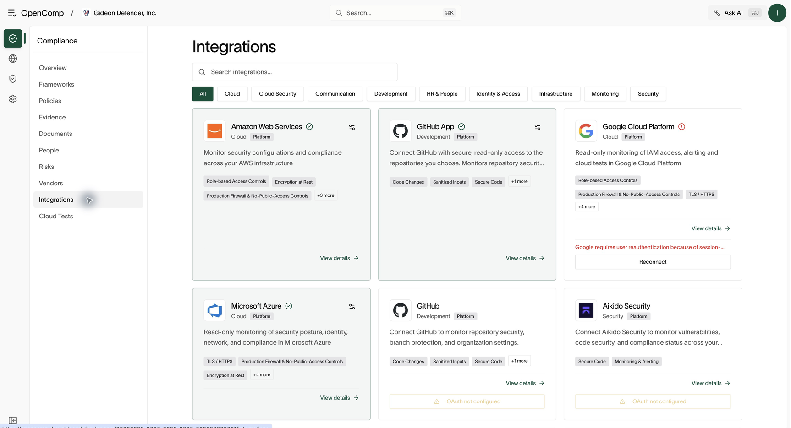

*The catalog groups integrations by category and shows task links, connection details, and connection errors.*

Use category buttons or **Search integrations…** to find the provider. Task links explain which evidence the integration supports. **Reconnect** means an existing connection needs attention; **OAuth not configured** requires platform configuration. Repeated sign-in attempts do not fix missing OAuth application credentials.

Requires `integration:read`; connect `integration:create`; manage/run `integration:update`; remove `integration:delete`.

- **Catalog** — search, category pills (Identity & Access, HR & People, Cloud Security, Development, Communication, Monitoring, Infrastructure), "Showing N" count. Cards sort connected first, then vendors you registered, then others; "Coming Soon" cards are visible but disabled. **OAuth not configured** appears when the platform admin hasn't set the OAuth app — repeated login won't fix it.
- **AI Agent custom integrations** — for anything without a native connector, the catalog shows agent-driven integration cards: a "How to connect" sheet with a setup hint, **copyable example prompts**, and **Relevant Tasks** matched to your org's task templates ("Just ask the agent…").
- **Provider detail** — connection selector across multiple accounts, evidence-task mapping panel, per-service grid, service detail page (toggle scanning per service; "Always scanned" baseline services show read-only states; **evidence supplied** links tasks that are satisfied when checks pass).
- Checkr has a dedicated detail page (§19); **OAuth error recording** captures failed redirects with messages for support.
- Health rules: reconnect promptly on expiry — stale integrations silently stop producing evidence; dedicated service identity recommended (access survives turnover); remove unused connections (every live credential is attack surface). If a connecting tool feeds **People** data, ensure it's picked as the People sync source (§16) (2FA status, people sync, device sync selection likewise).

## Read the integration’s connection state

The catalog is available at `/{orgId}/integrations`. Confirm the organization in the header, then use **Search integrations…** or a category filter to find the provider. Open the card or **View details** to inspect its connection and evidence-task mappings.

| State | What it means | What to do |
|---|---|---|
| Connected / Active | OpenComp has an active connection record. | Check the configured account, project scope, services, and latest collection result. Authentication alone does not prove evidence coverage. |
| Error with **Reconnect** | An existing connection cannot authenticate or refresh its credentials. | Read the error, then reauthorize the intended account. Use the GCP walkthrough below for Google session-control errors. |
| **OAuth not configured** | The deployment lacks the provider’s OAuth application configuration. | Ask the platform administrator to configure the application. Reauthentication cannot supply missing application credentials. |

The catalog’s OAuth reconnect action requires permission to create integration connections (`integration:create`). Viewing a connection needs `integration:read`; configuration and collection actions need the appropriate management permission. Ask an administrator if the required action is unavailable.

## Reconnect Google Cloud Platform

This walkthrough follows the real reconnect completed in the development workspace on **October 17, 2026**. It covers the expired authorization, Google verification and consent, return to the existing connection, and the remaining project-scope checks. Google can vary the verification screens according to the account and its organization’s policies.

### 1. Read the GCP error and choose Reconnect

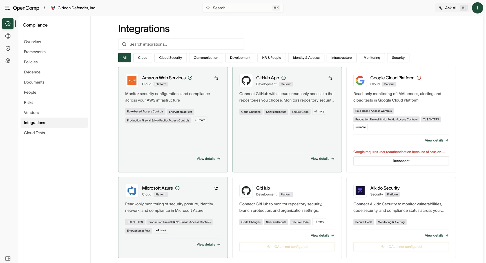

*Before reconnect: the GCP card shows an error and offers Reconnect.*

The full error in this session was: **“Google requires user reauthentication because of session-control policy (invalid_rapt). Please reconnect the integration.”** This means Google requires an interactive identity check before OpenComp can refresh access. It is different from **OAuth not configured**.

Choose **Reconnect** on the **Google Cloud Platform** card. Do not disconnect the account as a first step: the goal is to renew its authorization, not remove its records. Reconnect opens Google in the same tab.

### 2. Choose the intended Google account

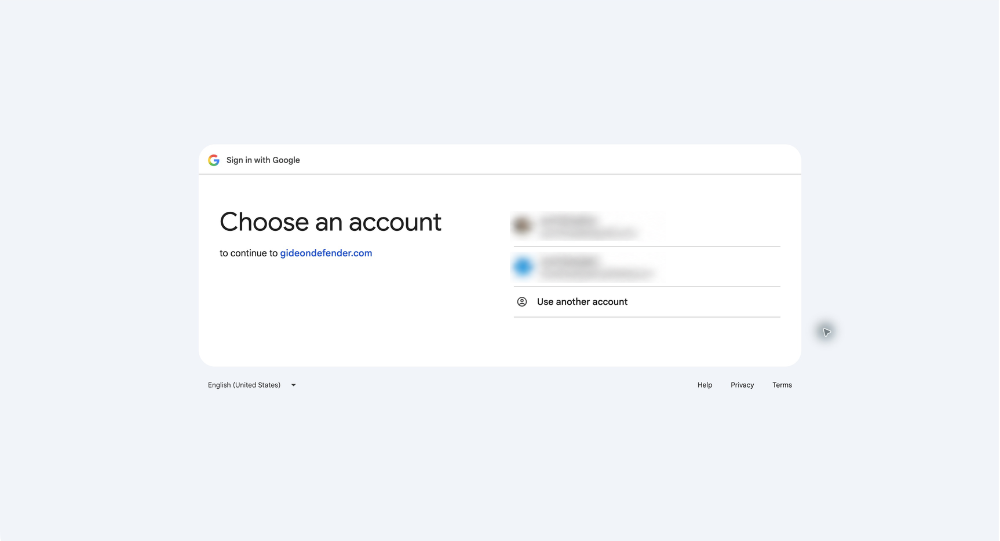

*Google asks which account should authorize the integration. Names, email addresses, and avatars are blurred for privacy.*

Choose the account your organization uses for this GCP connection. Check the full email address when personal and work accounts appear together. Use **Use another account** only when the intended identity is absent. The account must have the required access to the GCP organization and projects; signing into OpenComp as an owner does not grant Google Cloud permissions.

### 3. Complete Google’s identity verification

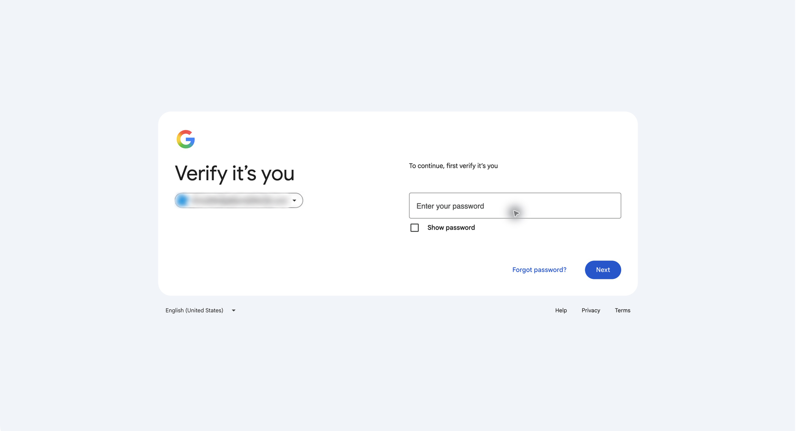

*The session-control policy requires the account holder to verify their identity. The account email address and avatar initial are blurred for privacy.*

In this run, Google displayed **Verify it’s you** and requested the account password. Complete the requested sign-in or additional verification directly in Google. Do not put passwords or verification codes into OpenComp Context, task comments, support messages, or screenshots. The captured password field is empty.

### 4. Continue the returning sign-in

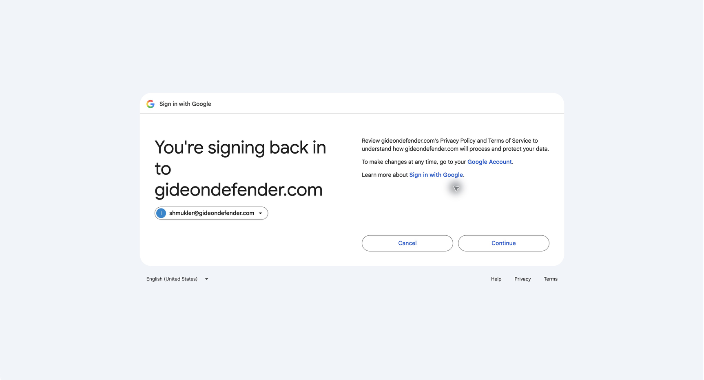

*Google identifies the application before the access review.*

Confirm the selected account and the application name, then choose **Continue** to review the permission request. This screen does not yet prove the GCP connection has recovered; the flow must return to OpenComp.

### 5. Review the actual Google permissions

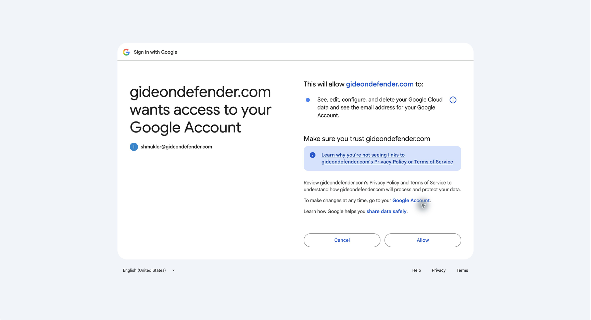

*The consent screen states the permissions Google will grant to the integration.*

In this run, Google asked to let **gideondefender.com** **“See, edit, configure, and delete your Google Cloud data and see the email address for your Google Account.”** Review this scope with the person responsible for the cloud account. The catalog’s **Read-only monitoring** description does not describe the breadth of this Google permission request.

Choose **Allow** only when the application, account, and requested access are approved. Choose **Cancel** if they are wrong or exceed your organization’s approved access. Google administrator policy can block consent; resolve that policy or application-approval issue with the administrator rather than repeating the same login.

### 6. Confirm the return to the existing connection

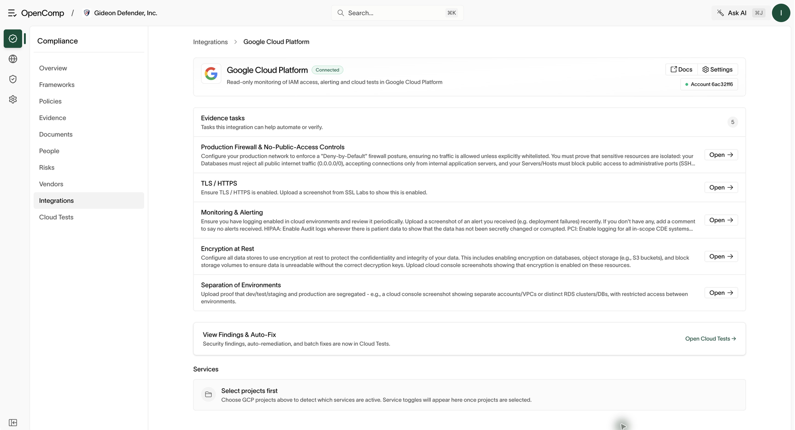

*After Google consent, OpenComp returns to the GCP provider detail page with Connected status.*

The browser returned to `/{orgId}/integrations/gcp`. Check the organization and selected account. Open **Settings** to inspect the connection status and configuration. In this run, **Account Settings** showed **Active** and retained the existing **Created** date of October 5, 2026.

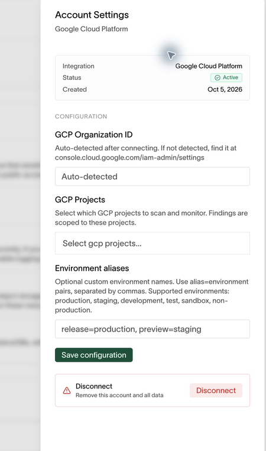

*Account Settings confirms the active connection and exposes its scan-scope configuration.*

**Disconnect** is a separate action at the bottom of the panel. It is not the next step in reconnecting.

### 7. Check organization and project scope

The configuration panel contains:

- **GCP Organization ID** — auto-detected when available. If blank, the panel points to `console.cloud.google.com/iam-admin/settings` to find it.
- **GCP Projects** — the projects this connection will scan and monitor. Verify the intended project IDs before saving.
- **Environment aliases** — optional mappings such as `release=production, preview=staging`. The panel lists the supported environment names.

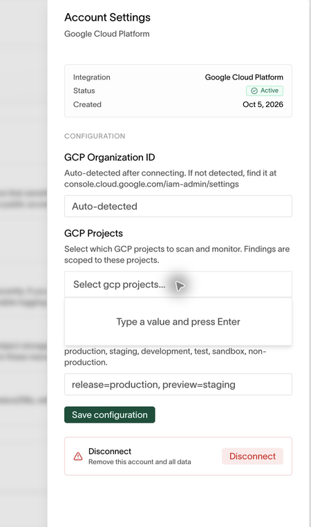

*The captured project picker accepts project values; no projects were selected during this walkthrough.*

Open **GCP Projects**. In the captured deployment, its prompt says **Type a value and press Enter**. Enter an approved project ID and press Enter to add it; review the selected values before **Save configuration**. Save only the intended scope, then reopen Settings to confirm it persisted. Closing the panel without saving does not establish the missing project scope.

No project IDs or environment aliases were added or saved during this capture. Reauthentication succeeded, while scan-scope configuration remained outstanding.

### 8. Verify the catalog and evidence collection separately

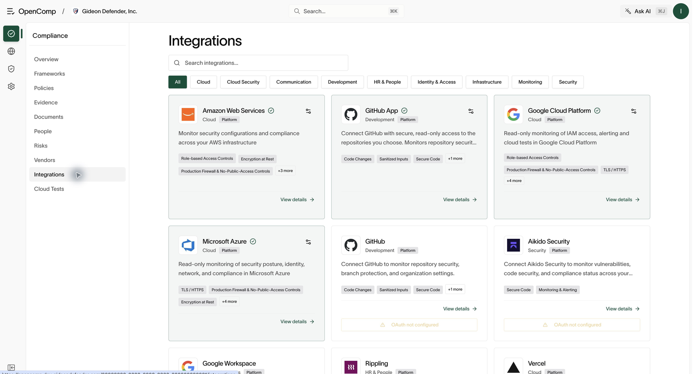

*After reconnect: the GCP error and Reconnect action are gone.*

Return to **Integrations** and verify that the previous error is absent. Then open GCP’s provider page and choose **Open Cloud Tests →**. Cloud Tests should select **GCP**; verify the intended connection there as well.

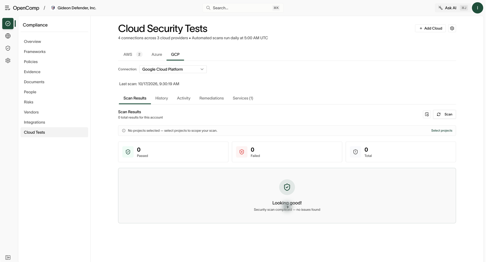

*Authentication has recovered, but the captured connection has no selected projects and no scan results.*

In this run, Cloud Tests still displayed **“No projects selected — select projects to scope your scan.”** The **Select projects** link returns to the GCP provider page; use its **Settings** action for configuration. The provider’s **Select projects first** service message also means discovery has not been scoped.

After an approved project configuration is saved, check service discovery and run or inspect collection in **Cloud Tests → GCP**. Confirm the account, selected projects, scan timestamp, result count, and any permission errors. A **Connected** badge, **Active** status, or **“Looking good!”** message with **0 total results** does not establish working coverage. No scan was started in this walkthrough.

## GCP reconnect troubleshooting

| Symptom | Next step |
|---|---|
| `invalid_rapt` returns after a period of time | Ask the Google administrator about the account’s session-control policy. Complete fresh verification when required; one reconnect does not change that policy. |
| Google offers the wrong account | Switch to the identity approved for this connection before consent. |
| Google blocks consent or requests unexpected permissions | Stop and ask the cloud or Google administrator to review the application and requested access. |
| Google returns to OpenComp with an error | Retain the visible error and provider name for support. Do not share the full callback URL, OAuth codes, or tokens. |
| GCP is Connected but says Select projects first | Open the provider’s Settings, configure approved project IDs, save, and reopen to verify. |
| No projects selected appears in Cloud Tests | The connection is authenticated but lacks a scan scope. Follow Select projects back to GCP Settings. |
| Project collection reports insufficient permissions | Confirm the selected account can access the chosen projects and has the required GCP permissions. Reauthentication alone does not grant missing IAM access. |
| The old error remains after reconnect | Reopen the intended connection and check its status. Confirm the Google flow completed and returned to the correct organization. |

---

# 25. Security questionnaires

Feature flag `ai-vendor-questionnaire`; `questionnaire:read` to view, `questionnaire:create` to upload, `questionnaire:update` to answer/edit, `questionnaire:delete` to remove. **Requires published policies** — the empty state blocks and points at Policies.

- **Upload** (`New Questionnaire`) — one file, ≤100 MB: PDF / XLSX / CSV (no Word; convert first). Parse stages: Getting ready → Reading document → Finding questions → Almost done. Check every question was captured.
- **Answer** — **Auto-answer all** queues per-question completions drawn from your **published policies**, **Context entries**, **Knowledge Base documents**, and prior answers; each answer shows its **sources**; unanswered rows fall back to "N/A – no evidence found" instead of inventing claims. Edit inline; answer one-by-one; progress bar (answered/total).
- **Export** — XLSX, CSV, or PDF; verify question↔answer mapping before sending. You sign the response, not the AI: watch for scope errors ("we do X" when only one team does).
- Tabs on the main page: **Security Questionnaire** (your saved questionnaires) and **Knowledge Base** (the four-section KB, see §26). The standalone `knowledge-base` route shows the same content outside the questionnaire.

> Feed the loop: every time you answer the same one-off twice, capture it as a Context entry (§26); refresh manual answers when addresses, subprocessors, or certifications change.

---

# 26. Knowledge Base and Context Hub

The knowledge surface has four sections (visible both standalone and as the questionnaire tab):

1. **Published policies** — only published, non-archived policies count. Links into each policy; read-only here.
2. **Context** — the Q&A pairs from Settings → Context Hub; editing happens there (§3). Structured answers (objects/arrays) render read-only previews here.
3. **Manual answers** (`questionnaire:create` to manage) — approved reusable answers with tags and the originating questionnaire; delete individually or "Delete all" (confirm).
4. **Additional documents** (`questionnaire:create`) — upload up to 10 files at a time (100 MB each): PDF, Word, Excel, CSV, text/markdown, images. Uploads automatically **process into the vector store for AI**; status chips show pending → processing → completed/failed; delete runs a vector-deletion job. View/download uses signed URLs.

A **website crawler** is not part of the KB: web research lives inside the automation builder (§10) and the Ask AI toolset.

---

# 27. Browser extension

Chrome extension that fills third-party questionnaires from your knowledge base, inside the requester's page.

- **Install & sign in** — Chrome Web Store; sign in to OpenComp in Chrome (uses your browser session); pick the intended organization; keep detection on.
- **Flow** — open the questionnaire page (extension detects it) → generate answers from your KB → review each answer in the side panel (edit anything wrong) → approve → insert into page fields.
- **Guardrails** — first generate and first insert on a new domain require confirmation; batch inserts always confirm; switching organizations clears drafts. For Google Sheets, verify the **question column, answer column, and row range**; for Google Docs, answers export via clipboard for manual paste.
- **Troubleshooting** — signed out: sign in in the same Chrome profile; no questions detected: use the upload flow in the app; "needs review": inspect sources, don't approve a guess; wrong destination: reconfirm workspace/domain/columns.
- Extension answers aren't saved unless you route them back through the app's questionnaire record flow. Thin answers mean the KB needs feeding — flag it, don't invent facts.

---

# 28. Trust Center (admin surfaces)

Rail: **Trust** → pages **Overview (Portal settings)**, **Access requests**, **Trust settings**. Gates: `trust:read` view, `trust:update` change.

## Portal settings (Trust overview)

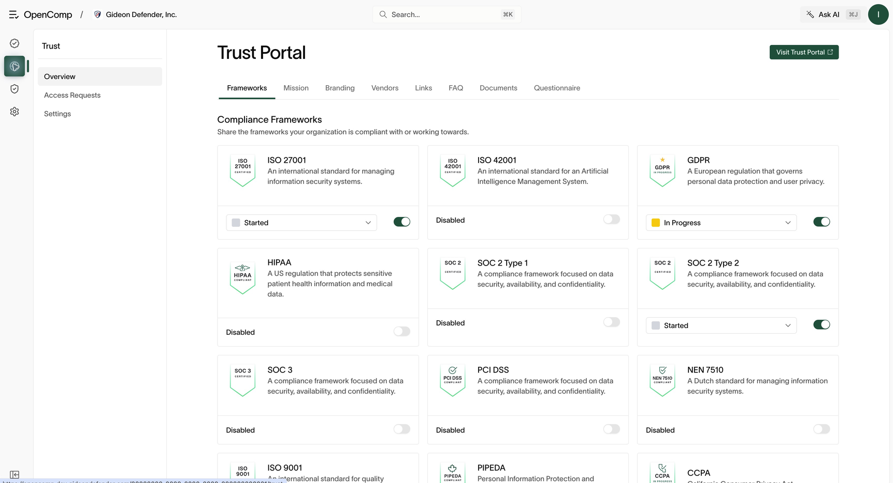

*Trust Portal → Frameworks shows independent publication switches and maturity statuses for each framework.*

Review the status wording before making a framework visible. **Started** and **In Progress** describe work toward a standard; they are not certificates. Use **Visit Trust Portal** to check the public presentation after an approved change. The screenshot shows configuration controls, not proof of certification.

- **Enable toggle** — portal on/off (this autosaves immediately, along with the contact email and primary color; everything else has dedicated endpoints).
- **Getting Started banner** appears while unconfigured: 1) toggle the frameworks you work toward; 2) published policies surface automatically (drafts/private updates stay hidden); 3) add the custom domain + contact email.
- **"Visit Trust Portal"** opens the public site — opening is not a separate publish step.
- Configure tabs: **Frameworks** (17 toggles incl. SOC 1/2/3, ISO 27k/42k/9k, HIPAA, GDPR, PCI DSS, NEN 7510, PIPEDA, CCPA, DORA, NIS 2, HITRUST, NIST CSF/800-53; per-framework status selection `started/in_progress/compliant`; certificate PDF upload), **Mission** (mission/commitment/about editor; named Content in some versions), **Branding** (favicon; primary color autosaves), **Vendors** (show-on-portal per vendor from your vendor register + compliance badges per vendor + logos), **Links** (custom links with order), **FAQ** (Q&A builder), **Documents** (additional documents with upload/download/delete), **Questionnaire** (Visibility toggle for the public security-questionnaire widget — hide it while no one is staffed to answer). **Custom frameworks** add named badges to the public list.
- The toggle honesty rule: **published** only — "Started"/"In progress" must not be presented as certifications.

## Trust settings

- **Contact information** — the email displayed to visitors.
- **Custom domain** — add domain → records shown are CNAME + a TXT verification target; "Check DNS now" re-verifies; the status columns drive the portal URL (`https://trust.gideondefender.com/{slug}` until the custom domain is verified).
- **Allowed domains / Allowed emails** — the **NDA bypass list**: exact email-domain or exact-email matches approve requests **without an NDA** (grant issued immediately at approval, marked "NDA bypassed" in the audit trail).

## Access requests & grants

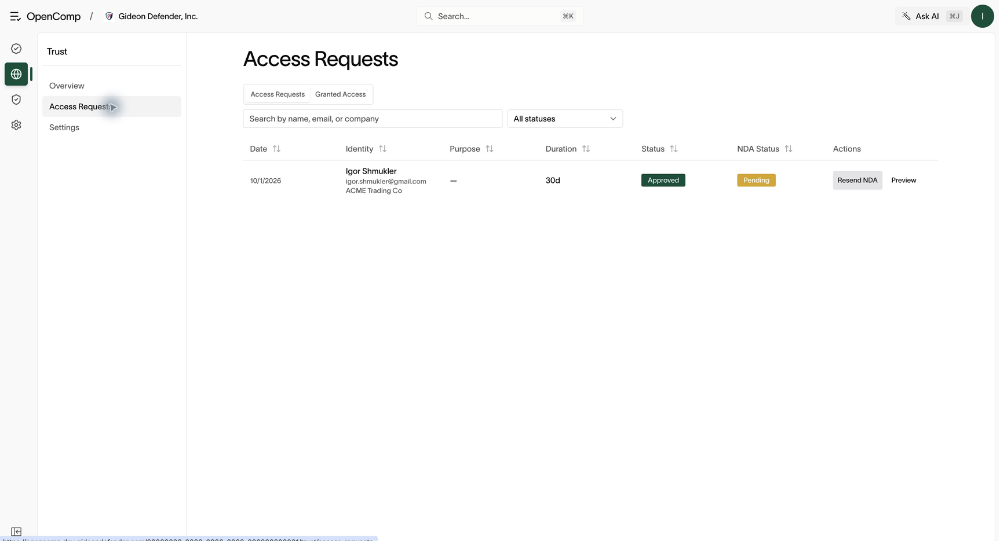

*An approved Trust access request still has NDA Status Pending, with Resend NDA and Preview actions.*

Check both columns. **Approved** does not alone prove that a visitor has finished the NDA flow or obtained access. Use **Granted Access** to verify the resulting grant and expiry. **Resend NDA** sends an email; use it only when the recipient needs another signing link.

Access Requests page has two tabs.

**Requests tab** — workload of inbound requests (from the public portal or the questionnaire entry), with search, status filter (Under review / Approved / Denied), duration (requested; default 30 days), status badge, and **NDA status** (Pending / Signed / —). Actions:

- **Approve** — dialog shows the requester (name/email/company/title/purpose) with an editable access duration in **7–365 days**; "Approve & Send NDA" sends the signing link. Bypass-listed requests skip the NDA and are granted instantly.
- **Deny** — requires a reason.
- **Resend NDA** — when approved but not signed.
- **Preview** — open the NDA PDF in a new tab (browsers pop up a blocker reminder).
- The public `?query=security-questionnaire` entry point pre-fills the purpose as "Security questionnaire" for the internal review queue.

**Granted Access tab** — active/revoked/expired grants with expiry dates; **Resend Access** re-emails the link (disabled once expired); **Revoke** requires a reason; visitors can use the public "reclaim access" link themselves to re-receive the email. Access grants expire; links are single-use and 24 h limited. Review grants quarterly.

## Trust public portal & grant reads (see §29)

Public site shows: profile, frameworks (with your chosen badges and status wording), **control names** and overview, FAQs, vendors, custom links, favicon, custom frameworks, documents, and the security-questionnaire entry — **published policy content itself stays behind the access-grant flow**.

---

# 29. Trust Center (public portal and grants)

Visitors flow (public site, rate-limited):

1. **Browse** Overview / Security controls / Subprocessors — transparency without an account. If no policies are published, the policy section renders empty (publish before you promote).
2. **Request access** (name + work email; company/title/purpose optional; the questionnaire entry pre-fills purpose) — submission ≠ access; your team reviews it.
3. **NDA** (unless bypassed) — the emailed link opens the NDA; **preview/PDF, then sign** ("accept" required); signature watermarks the PDF, records IP/UA, and creates the grant.
4. **Access** — the grant area shows: published policies (list/download/zip), compliance/certification files, additional documents; downloads are single-use, 24 h links. An expired/stalled grant can be re-emailed with the public **reclaim access** request. If a grant holder reports "No documents found": the document was unpublished/no longer included before the download, the grant expired, or the approval ended without added files.
5. Access removal: admins **Revoke** (reason required) or grants simply expire.

---

# 30. Auditor view

Strict gate: built-in auditor role **or** a custom role with explicit `audit:read` (owner/admin implicit permission doesn't count toward the sidebar visibility) — §2. Content, read-only:

- **Company Information** — logo (download), employee count, report signatory, executive team.
- **Business Overview** — background/operations, services description, system description.
- **Third-Party Dependencies** — critical vendors and subservice organizations.
- Values render "Not yet available" until their Context entries exist. Header: **Export evidence** (bundle download, org-anchored filename).

Auditors also self-serve: **Export All Evidence** on the Evidence page (auditor/admin/owner roles), the SoA (read), and any per-page exports. Internal-only notes: task Comments and Activity are for your team — state which threads auditors may rely on externally; do not treat "auditor view" as including unpublished drafts.

Previewing as auditor: assign the auditor role (or `audit:read`-containing custom role) to a test user in Gideon, sign in, walk the view, then remove.

---

# 31. Ask AI assistant

The app header has an assistant ("Ask OpenComp something…"), available with `app:read`:

- **Read-only by design** — for the session user; org and tenant pinned to your current org; it cannot create/update/delete anything. Never claim changes; asks for data, not mutations.
- **Toolset is permission-scoped**: always org + your info; with `policy:read` it can retrieve policies (including drafts) and their content; with `risk:read`, the risk register (filterable). For anything else it says it can't access that information rather than fabricating.
- Guardrails: answers "I don't know" when unsure; grc-focused persona; markdown output; history per user per org (clearable); a practical tool budget stops loops.
- Good prompts name the tool and the read-only constraint: "…Report the returned count and summarize the tasks. Read only; do not change records."

For agent-driven automation, use MCP/API (§33).

---

# 32. Email, notifications, preferences

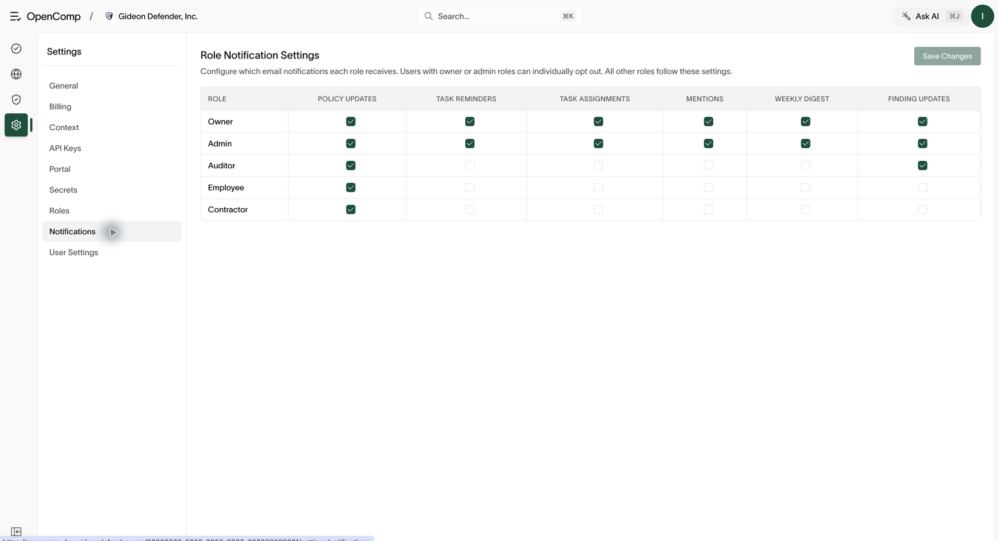

*Role Notification Settings shows role defaults across six email categories and a Save Changes button.*

Read the row for the intended role before changing any checkbox. The captured matrix covers policy updates, task reminders, task assignments, mentions, weekly digest, and finding updates. This differs from the personal preferences list. **Save Changes** is disabled until the matrix changes; a checked box is a preference, not proof that an email was delivered.

- **Personal** (Settings → User Settings) — seven switches described in §3; admins set their own; non-admins see role-controlled switches as locked with "managed by admin."
- **Role defaults** (Settings → Notifications) — matrix per role; Save only when changed; changes affect everyone in that role except users who opted out individually. Review after role changes so alerts reach the right people.
- **Digest & reminders** — weekly task digests, task reminders/assignments/mentions, policy-update emails, and finding notifications flow through the app's email templates; transactional announcements include an **unsubscribe/preferences link** leading to a public preferences page per recipient.

---

# 33. Automation and API access

Credential style: interactive users ride Gideon SSO sessions; automation uses **scoped API keys**; MCP exposes operations to agents.

## API keys

Create in Settings → API Keys (`apiKey:read`/`create`/`delete`): see §3. Requests carry the header **`x-api-key`** and the deployment base URL. A key's abilities equal its selected scopes — connection alone never grants permissions; 401 means deployment/key/auth error, 403 means the scope is missing. Rotation: create replacement → update secret store → verify a read → revoke old.

## MCP

Clients connect to OpenComp's MCP layer:

| Method | Use when | Setup |
|---|---|---|
| **Hosted HTTP** | Client supports Streamable HTTP | endpoint + `apikey` header with org key |
| **Local stdio** | Client launches command servers | approved bundle, Node.js ≥22, API URL + `COMPAI_APIKEY` env; `--tool` allowlist restricts exposed operations; versions should be pinned to a verified published release |
| OAuth connection | Client requires OAuth | separately configured OAuth credential (different setup from API-key modes; don't mix) |

Dynamic servers expose discovery (`list_tools` → `describe_tool_input` → `execute_tool`); static local servers expose selected business tools directly. Verify with a read (e.g., list tasks) and compare against the UI in the same organization. See `mcp-setup.md` / `mcp-examples.md` for exact calls, headers, and troubleshooting tables (401/403/503 semantics, `isError` handling, mutations need review and approval process, never blind-retry a timed-out mutation).

## Exports & auditor packaging

`Export All Evidence` (bulk job) and auditor self-serve exports produce control-linked evidence packages. Verify the period, records, attachments, and control context, and share via your approved channel.

---

# 34. Employee portal (complete)

A separate, simpler app (portal URL; same Gideon SSO) for portal-only roles and everyone who was assigned compliance work. Access = role with portal obligations (a member of many orgs can pick which org to work in).

## Org picker

With several memberships you pick the organization; with none you see the no-access message.

## Dashboard

Progress bar "x of y tasks completed" and accordion task sections:

1. **Security policies** — each required policy with Accept action (timestamped; counts as audit evidence — read them). The policy page shows the full content (rich text or PDF), an "Accepted" banner once signed, and a Signed-policies list elsewhere in the nav.
2. **Device agent** (if enabled) — your enrolled devices with last check-in and "All passing"/"Needs attention"; install flow (OS auto-detect, download, per-OS instructions, sign-in); legacy Fleet fallback (refresh + per-policy status with **image upload proof** for manual evidence).
3. **Security awareness training** (if enabled) — video carousel (Security Awareness Training parts 1–5) with per-video **Mark complete** (generates the certificate PDF and emails); counter badge. No quiz — completion is the certificate.
4. **HIPAA training** (HIPAA orgs) — reading sections + video with the same completion/certificate/cert-email flow.
5. **Company forms** — when portal-enabled: **Access Request** (username, accounts needed, permissions needed read/write/admin, reason, granted-by, date; then **My submissions** with status Pending/Approved/Rejected + review reason) and **Whistleblower Report** (incident date, complaint details, individuals involved, evidence text + optional file; confidential).
6. Devices (see §20) status card.

Outstanding items follow the employee until done; the acceptance is timestamped and feeds people/org compliance columns (§16–17).

---

# 35. Platform flows

- **Sign-up/booking/upgrade** — the standalone upgrade page walks organizations that need the security product through plan selection and a booking step; on success a post-payment onboarding screen collects context ("onboarding"-tagged entries) that feeds AI feature quality.
- **Setup** — a setup-session flow (setup link → confirm your organization form) provisions the workspace for a first admin. Organization access requires a verified Gideon assignment.
- **Referrals** — `/{orgId}/referrals` embeds your partner dashboard (referral link sharing and tracking). Unlinked from navigation; reachable by deep link.
- **Unsubscribe** — public email preference + unsubscribe pages pay respect to per-recipient toggles (workflow endpoints).
- **Search everywhere** — ⌘K global search across the app.

---

# 36. Troubleshooting

| Symptom | Likely cause / path |
|---|---|
| Whole app "No access" | Role lacks `app:read` — portal-only user; use the portal. |
| A button/section is missing | Check its permission (per section above), plan/feature flag, or subscription; destructive/delete buttons hide without the delete permission. |
| Sign-in denies access | No Gideon entitlement for that org; assign in Gideon. |
| An old invite link shows an invitation-retired notice | OpenComp invitations no longer grant access. Ask an administrator to assign access in Gideon, then sign in normally. Previously accepted links can still redirect existing members to their organization. |
| Sessions run after offboarding | Gideon revocation lands at next reconciliation (~5 min), not instantly. |
| Policy won't publish | Awaiting approver; check pending version and approval banner. |
| Employee can't see policy | Not published, or portal access/assignment missing. |
| Coverage didn't move after publishing | Check Mappings, publication status, and the right framework; an upload alone doesn't map. |
| Evidence export is empty/small | Filters, attachments exist?, exports scope; a download success ≠ completeness. |
| Automation keeps failing | Read the run's evaluation reason; fix cause; don't re-run blind. |
| Sign-in fails (browser automations) | Vendor changed login; reconnect; check TOTP setup key vs rotating code. |
| GCP shows Reconnect / `invalid_rapt` | Follow the [GCP reconnect walkthrough](#reconnect-google-cloud-platform); verify project scope and collection after Google reauthentication. |
| Cloud scan permission errors | Add missing named permissions to the role; re-run; persistent errors are findings. |
| Cloud scan zero results, even with “Looking good!” | Confirm account, enabled services, configuration, permissions, and history; zero checks do not prove coverage. |
| Pentest "No active plan" | Billing add-on; ask billing admin; grant + allowance. |
| Pentest failed | Open failure detail; fix target/config; re-run. |
| Questionnaire route 404s | Feature flag off in this deployment; ask an administrator. |
| Questionnaire upload rejected | Word doc or >100 MB — convert / resize. |
| KB upload "processing" too long | Check processing status; re-upload if failed; verify supported types. |
| Trust domain verify fails | Apply exact DNS records; "Check DNS now"; then re-open portal. |
| Visitor "No documents found" | Unpublished/expired grant/gap; re-approve after publishing. |
| Auditor can't see sidebar item | Requires auditor role or explicit `audit:read` custom role in Gideon. |
| MCP 401/403/503 | Deployment+key mismatch / scope missing / service unavailable; see `mcp-setup.md`. |
| MCP "wrong org" | Active-org pinning/tenants; recheck org selection. |
| Portal form error page | Required field/file missing (>100 MB); check `?error=` banner. |
| Portal training not saving | Reload; if it persists, report step name + error; don't just re-click. |

---

# 37. Reference

## Permission resources and typical actions

| Resource | Read | Write (create/update/delete) |
|---|---|---|
| `app` | enter the app | — |
| `framework` | list/detail | add, custom create, version apply, delete |
| `control` | detail | delete (list is read-only) |
| `policy` | content | create, publish/approve, version, archive/delete |
| `evidence` / `task` | attachments/zips/uploads | create/assign/status/bulk, export |
| `member` (`people`) | directory | outcomes, devices, background ops |
| `risk`, `vendor` | registers | fields, plan, mining tasks |
| `trust` | requests/grants | approve/deny/revoke, settings |
| `integration` | catalog | connect/scan/configure/disconnect |
| `finding` | list/detail | update = status transitions; create/delete are auditor-only; templates |
| `questionnaire` | view files | upload/answer/export/delete |
| `audit` | auditor & SoA reads | SoA ensure/approve (no delete action) |
| `pentest` | scans | run/edit context |
| `backgroundCheck` | candidates/reports | create (order screen); no update/delete |
| `training` | — | update (completions) |
| `portal` | employee self-service | update (submit/sign) |
| `apiKey` | list | create/revoke (no update) |
| `secret` | list (reveals plaintext) | create/edit/delete (owner/admin only) |
| `ac` (roles) | roles pages | create/edit/delete roles |
| `organization` | read | update = preferences/portal/billing; delete = owner only |

## Feature flags and gates

| Gate | Effect |
|---|---|
| `is-timeline-enabled` | Overview Timeline tab; framework Progress tab |
| `is-web-automations-enabled` | Browser automations; Browser connections settings |
| `is-isms-enabled` | ISMS area (plus ISO 27001 active) |
| `is-ai-policy-assistant-enabled` | AI policy editor |
| `ai-vendor-questionnaire` | Questionnaire pages + Knowledge Base in compliance nav |
| Enterprise automation license | AI automation builder |
| Plans: pentest / background-checks add-ons | Security product run credits |

## Hard limits

- Attachments & KB & questionnaire & org-chart image uploads: **100 MB** per file.
- Questionnaire upload: **1 file** (PDF/XLSX/CSV); Word rejected.
- Trust access duration: **7–365 days** (default requested or 30).
- Org name ≤ `32` chars; logo ≤ `2 MB`; finding context ≤ `4000` chars (pentest run context), per-finding note `≤2000`.
- Role name: `2–50` chars, starts with a letter.
- Secrets: `UPPER_SNAKE` names.
- SoA/ISMS exports: PDF (+DOCX for ISMS); CSV exports for forms and devices.
- Screenshot provenance: **October 17, 2026**, live development workspace in Chrome; see [capture records](images/manual/captures.json). Labels and availability vary.

## Glossary quick-links

See `glossary.md` for canonical terms (Access request, Approval, Control, Evidence, Finding, Framework, Gideon, ISMS, Knowledge base, Member, Portal, Remediation, SoA, Task, Trust Center, Vendor).

---

*Companion topic pages (deep dives): getting-started, compliance-overview, policies, evidence-and-tasks, people, employee-portal, integrations, questionnaires, documents-isms, risk-and-vendors, trust-center, cloud-security, security-penetration-tests, background-checks, devices, browser-automations, browser-extension, roles-and-access, organization-settings, automation-and-api, mcp-setup, mcp-examples, faq, glossary.*
